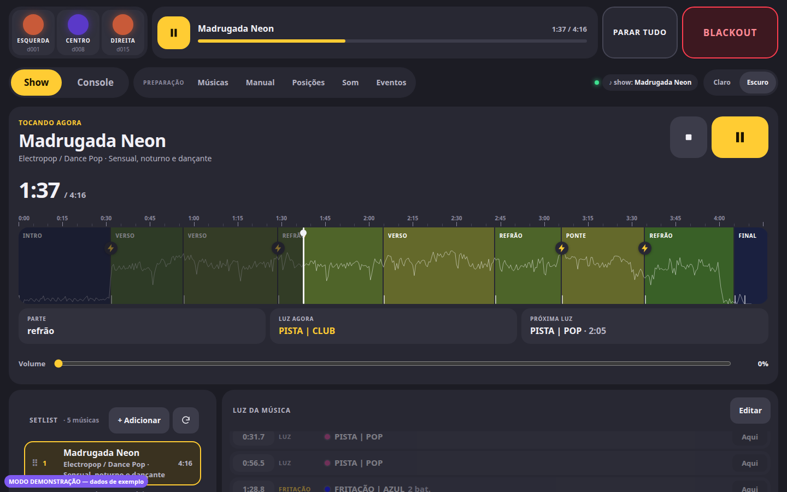
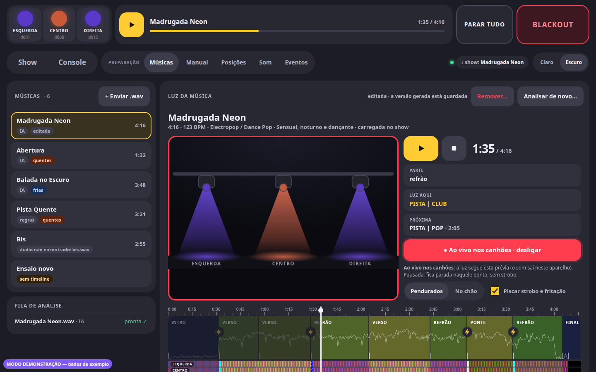
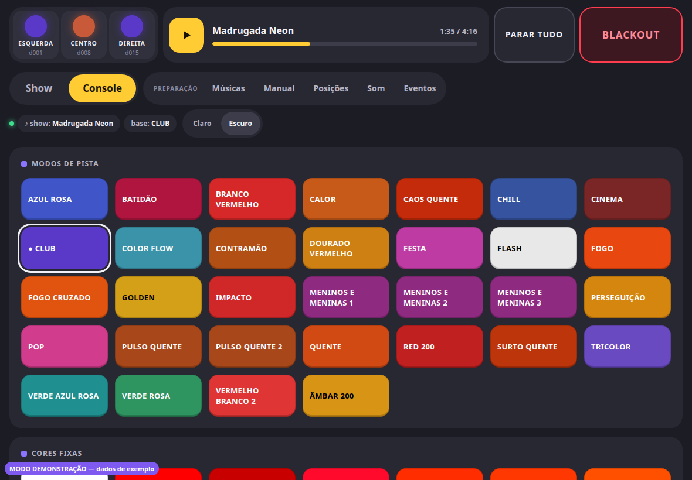
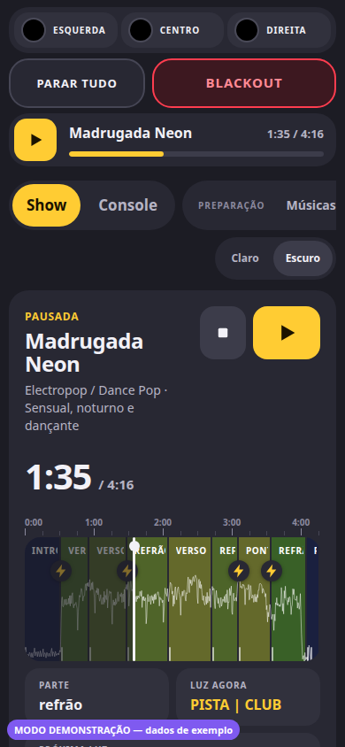

# DMXController

**Luz automática para show ao vivo**: toca as músicas, cria uma "timeline de
luz" para cada uma a partir do áudio (com IA opcional) e comanda os canhões
LED por DMX em sincronia, com um console de presets que abre no iPad e no
computador ao mesmo tempo.

[](https://github.com/ncastellani/DMXController/actions/workflows/ci.yml)
[](LICENSE)
[](go.mod)



Feito em Go para o pequeno show de um cantor (voz ao vivo sobre playback, 3
canhões LED RGB). É um binário só e **não tem interface no terminal**: ele
imprime os endereços da página, e todo o controle e o log ficam nela. Foi
desenvolvido e testado no Linux (Ubuntu); no show vai rodar num **Raspberry
Pi 5**. Também roda no **Windows** e no **Mac** (ainda não testados com o
equipamento).

**Experimente sem instalar nada**: a [demonstração online](https://ncastellani.github.io/DMXController/)
é a mesma interface com dados de exemplo (sem som e sem DMX).

> [!WARNING]
> O programa comanda **strobo** (luz piscando). Ele tem limites de tempo e de
> frequência pensados para pessoas com fotossensibilidade (ver
> [Segurança](#segurança-fotossensibilidade)), mas quem opera a luz continua
> responsável pelo que acontece no palco.

> **In English:** DMXController is a Go program that plays a show's backing
> tracks, analyses each song (beats, sections, drums; optionally with an LLM via
> OpenRouter) to generate a light timeline, and drives DMX LED fixtures in sync
> through an Enttec Open DMX-compatible USB interface, on Linux, Windows and
> macOS. A web UI (tablet and
> desktop) offers a live preset console, a 2D preview and a timeline editor.
> Code, UI and docs are in Brazilian Portuguese. Try the
> [online demo](https://ncastellani.github.io/DMXController/).

Este README é a documentação inteira do projeto: primeiro o manual de uso,
depois a referência técnica (formatos, protocolo, arquitetura) e as notas de
desenvolvimento.

## Índice

- [O que o programa faz](#o-que-o-programa-faz)
- [Do que você precisa](#do-que-você-precisa)
- [Instalação](#instalação)
- [Manual de uso](#manual-de-uso)
  - [Primeiro contato, sem equipamento](#primeiro-contato-sem-equipamento)
  - [Ligar o equipamento](#ligar-o-equipamento)
  - [Adaptar a outros canhões](#adaptar-a-outros-canhões)
  - [Preparar as músicas](#preparar-as-músicas)
  - [Montar a setlist](#montar-a-setlist)
  - [Som e atraso](#som-e-atraso)
  - [Durante o show](#durante-o-show)
  - [Rede e acesso](#rede-e-acesso)
  - [Linha de comando](#linha-de-comando)
  - [Problemas comuns](#problemas-comuns)
- [Segurança (fotossensibilidade)](#segurança-fotossensibilidade)
- [Arquivos e configuração](#arquivos-e-configuração)
- [Biblioteca de presets](#biblioteca-de-presets)
- [Como a análise cria a luz](#como-a-análise-cria-a-luz)
- [Formato da timeline](#formato-da-timeline)
- [Protocolo da interface web](#protocolo-da-interface-web)
- [Arquitetura](#arquitetura)
- [Desenvolvimento](#desenvolvimento)
- [Regras e decisões](#regras-e-decisões)
- [Estado atual e próximos passos](#estado-atual-e-próximos-passos)
- [Histórico](#histórico)
- [Licença](#licença)

## O que o programa faz

A página tem duas abas de show (**Show** e **Console**) e cinco de preparação
(**Músicas**, **Manual**, **Posições**, **Som** e **Eventos**).

- **Console**: 55 botões em 4 grupos (32 modos de pista, 12 cores fixas, 7
  fritações e 4 strobos contínuos), com atalhos de teclado. Modos de pista e
  cores dividem a mesma camada: um por vez, e apertar de novo apaga. A
  fritação só fica acesa **enquanto o botão está segurado**, e fritação e
  strobo têm tempo máximo (10 s e 60 s).
- **Show**: setlist (arrastar para reordenar), player com barra da música
  (partes, energia, ⚡ fritações), régua de tempo, volume e **músicas
  emendadas** sem corte. A luz segue a música em sincronia, e a lista de
  trocas de luz acompanha (só leitura, com "Aqui" para levar o show até uma
  troca; "Editar" leva ao editor). Os presets manuais ficam por cima da
  timeline, e ela volta quando eles saem.
- **Luz apagada por padrão**: ao iniciar, com música carregada, pausada ou
  parada, tudo fica preto. Só acende com a música tocando ou com um preset
  manual.
- **Músicas**: enviar `.wav` e analisar (ou analisar de novo), escolhendo a
  **temperatura das cores** (automática, quentes, frias), se usa a IA e o
  tipo de **Efeitos**:
  - **Presets**: só os modos de pista e as cores prontas da biblioteca.
  - **Livre**: sequências criadas para a música (escritas passo a passo, com
    várias cores e "frases" que mudam, como as de pista), que trocam de passo
    a cada toque da bateria ou da guitarra e nunca piscam rápido. A IA
    também pode usar um preset onde ele servir melhor, ou levar o desenho de
    um modo de pista para a música, como está ou com outras cores.
  - **Misto**: presets e efeitos na mesma música, cada um em pelo menos um
    terço das partes (em geral, presets nas partes mais agitadas).
- **A luz segue a batida**: a análise divide uma parte onde a bateria entra
  ou some (cada pedaço com a sua luz), usa a força da percussão para decidir
  a agitação e dá um **flash branco no canhão do centro** nos picos. Com o
  **ouvido de bateria** instalado (opcional), ela separa a bateria do resto
  da música e ouve a batida nela: os efeitos trocam no bumbo e na caixa (não
  na voz nem no sintetizador), as partes começam exatamente onde a bateria
  entra ou sai, e os picos são a entrada da bateria e as batidas soltas.
- **Luz até o fim do som**: a luz só apaga quando o som acaba, em fade se a
  música termina numa cauda.
- **Remover** uma música: ela sai da setlist e os arquivos vão para
  `musicas/lixeira/` (dá para recuperar de lá). Não remove a que está tocando
  no show.
- **Prévia e editor da luz** (aba Músicas): escolha qualquer música, sem
  carregá-la no show, e ouça no próprio aparelho com o **palco 2D** (os 3
  canhões acendendo) e a **faixa de cores** de cada canhão sob a barra da
  música. Edite as trocas de luz, fritações e apagões encaixados na batida,
  com cores da biblioteca ou criadas na hora, desfazer e restaurar a versão
  gerada. Num efeito, dá para mudar a cor de cada canhão em cada passo, o
  tempo do passo e o fade. Duas vistas do palco: pendurados (padrão) e **no
  chão, como no show** (os das pontas cruzando, o do centro para a plateia).
  A prévia não acende os canhões, a não ser com **Ver nos canhões**.
- **Ver nos canhões** (no editor): leva a prévia aos canhões de verdade, em
  tempo real. A luz segue a posição da prévia (tocando, pausada ou pulando
  na barra) e cada edição vale na hora, assim que é salva (menos de 1 s).
  Pausada, a luz fica parada no quadro daquele instante, sem strobo. O som
  continua saindo no aparelho da prévia, não na caixa do show. Desliga
  sozinho quando o show começa a tocar, com PARAR TUDO, ao trocar de música
  ou de aba, ao esconder a página ou se o aparelho para de responder por
  2 s. Não liga com a música do show tocando. Um aparelho por vez: o último
  que ligou conduz. Presets manuais ficam por cima, e o blackout apaga.
- **PARAR TUDO** (luz manual, blackout, **a música** e a prévia nos canhões)
  e **BLACKOUT** sempre à mão.
- **Manual**: um controle por canal de cada canhão, para testar a interface
  DMX e descobrir canais.
- **Posições**: troca de posição dos canhões no palco e "Identificar"
  (acende um canhão por 3 s).
- **Som**: saída de som, caixa Bluetooth (procurar, parear, reconectar
  sozinha) e calibração do atraso do som, que pode ser negativo (o som sai
  antes da luz).
- **Eventos**: log do que aconteceu.
- A interface DMX pode cair e voltar: o programa reconecta sozinho, e os
  alertas aparecem numa barra no topo da página.
- **Tema escuro** por padrão (para operar no escuro), com opção de tema
  claro. A página se ajusta ao computador, ao iPad e ao celular.

| Prévia e editor (aba Músicas) | Console | No celular |
|---|---|---|
|  |  |  |

## Do que você precisa

| Peça | O que serve | Usado no desenvolvimento |
|---|---|---|
| Computador | Linux (PC ou Raspberry Pi de 64 bits), Windows 10 ou 11 ou macOS (Windows e Mac **não testados** com o equipamento) | Ubuntu; no show, Raspberry Pi 5 de 4 GB |
| Interface DMX | USB do tipo **Enttec Open DMX**: chip FTDI, sem microcontrolador | SourLight SL1000 (FTDI FT232R `0403:6001`) |
| Canhões | aparelhos LED RGB com DMX. O programa foi pensado para **3** (esquerda, centro, direita) | 3× Mini Men MM-T114 em modo 7 canais, endereços **d001, d008, d015** |
| Som | qualquer saída do sistema: cabo, Bluetooth, HDMI, placa USB | caixa Mondial CM-400 por Bluetooth ou cabo P2 |
| Controle | navegador na mesma rede (iPad, celular, computador), quantos quiser ao mesmo tempo | iPad e o próprio computador |
| Internet | só para a análise com IA e para instalar o ouvido de bateria | — |

- **Interfaces "Pro"** (Enttec DMX USB Pro e parecidas, com microcontrolador
  e protocolo próprio), Art-Net e sACN **não são suportadas**. Numa Open DMX
  o computador gera o sinal DMX sozinho (BREAK, MAB, start code e 512 canais
  a 250 kbaud 8N2, ~28 quadros/s).
- **Só um programa por vez** pode usar a interface DMX: se o QLC+ (ou outro
  programa de luz) estiver aberto, feche antes.
- **Canais do MM-T114** (modo 7 canais): `1 dimmer | 2 R | 3 G | 4 B | 5 vazio
  | 6 função | 7 velocidade`. **Canal 6 = 50 + canal 7 alto = strobo
  nativo** (descoberto por Amós Junior). Fora do strobo, os canais 5 a 7
  ficam em 0. Para outros
  aparelhos, veja [Adaptar a outros canhões](#adaptar-a-outros-canhões).
- **Linux**: `termios2`/BOTHER + `TIOCSBRK`; os ioctls repetem em `EINTR`.
  **macOS**: `IOSSIOSPEED` + `TIOCDRAIN`, porta `/dev/cu.usbserial-*` (**não
  testado**). **Windows**: a porta COM do driver VCP da FTDI (o Windows o
  instala sozinho), `SetCommState` a 250000 baud, break por
  `EscapeCommFunction` e espera da transmissão por `ClearCommError` (**não
  testado**). `-dev auto` detecta a porta nos três (no Windows, pelas portas
  `\Device\VCPn` do registro).
- **Não rodar com `sudo`**: o som iria para o HDMI e os arquivos ficariam do
  root. A permissão da porta no Linux vem de uma regra udev (ver
  [Instalação](#instalação)).
- **Bluetooth no desenvolvimento**: dongle clone CSR/Barrot `0a12:0001`, que
  só funcionou na porta USB traseira.

## Instalação

### Programa pronto

Na página de [releases](https://github.com/ncastellani/DMXController/releases),
baixe o pacote da sua plataforma:

| Plataforma | Pacote |
|---|---|
| PC com Linux | `DMXController-<versão>-linux-amd64.tar.gz` |
| Raspberry Pi (sistema de 64 bits) | `DMXController-<versão>-linux-arm64.tar.gz` |
| Mac com Apple Silicon (M1, M2…) | `DMXController-<versão>-darwin-arm64.tar.gz` |
| Mac com Intel | `DMXController-<versão>-darwin-amd64.tar.gz` |
| PC com Windows 10 ou 11 | `DMXController-<versão>-windows-amd64.zip` |
| Windows em processador ARM (Surface Pro X, Copilot+ PC…) | `DMXController-<versão>-windows-arm64.zip` |

```bash
tar -xzf DMXController-v1.0.0-linux-arm64.tar.gz
cd DMXController
./DMXController -dev mock          # primeiro teste, sem interface DMX
```

No Windows, extraia o `.zip` (botão direito → Extrair tudo) e veja
[Windows](#windows-ainda-não-testado).

O pacote traz o binário, a configuração (`config/`), o `.env.example`, o
script do ouvido de bateria, este README e a licença. O `SHA256SUMS` da
release confere os downloads (`sha256sum -c SHA256SUMS --ignore-missing`).

### Compilar a partir do código

Precisa do Go 1.26 ou mais novo.

```bash
git clone https://github.com/ncastellani/DMXController.git
cd DMXController
go build -o bin/ .                         # gera bin/DMXController
```

Outras plataformas (compila sem cgo):

```bash
GOOS=linux  GOARCH=arm64 CGO_ENABLED=0 go build -o bin/linux-arm64/ .    # Raspberry Pi (64 bits)
GOOS=darwin GOARCH=arm64 CGO_ENABLED=0 go build -o bin/darwin-arm64/ .   # Mac M1/M2
GOOS=windows GOARCH=amd64 CGO_ENABLED=0 go build -o bin/windows-amd64/ . # Windows (gera DMXController.exe)
```

Nos exemplos deste manual, `./DMXController` é o binário: no pacote pronto
ele fica na raiz; se você compilou, é `./bin/DMXController`. No Windows, é
`.\DMXController.exe`. Rode sempre **de dentro da pasta do programa**: os
caminhos padrão (`config/`, `musicas/`, `.env`, `.ouvido/`) são relativos à
pasta atual (no Windows, abrir o `.exe` com dois cliques já faz isso).

### Linux: permissão da porta

Dê ao seu usuário acesso à interface DMX (uma vez só; não use `sudo` para
rodar o programa):

```bash
echo 'SUBSYSTEM=="tty", ATTRS{idVendor}=="0403", ATTRS{idProduct}=="6001", TAG+="uaccess"' | sudo tee /etc/udev/rules.d/70-sl1000.rules
sudo udevadm control --reload && sudo udevadm trigger --subsystem-match=tty
```

`0403:6001` é o FT232R da SL1000 e de muitos clones da Open DMX. Confira o da
sua interface com `lsusb` e troque na regra se for outro.

O controle de som e Bluetooth usa `wpctl`, `pw-dump` (PipeWire) e
`bluetoothctl`, que já vêm no Ubuntu e no Raspberry Pi OS com desktop.

### macOS (ainda não testado)

```bash
brew install blueutil switchaudio-osx
```

Se o sistema bloquear o binário, rode `xattr -d com.apple.quarantine DMXController`
(ou `bin/darwin-arm64/*`, se compilou).

### Windows (ainda não testado)

1. **Extraia o `.zip` numa pasta de caminho curto**, como `C:\DMXController`
   (o ouvido de bateria tem arquivos com caminhos longos).
2. **Abra o `DMXController.exe`** com dois cliques, ou num terminal
   (PowerShell) dentro da pasta, para passar opções:

   ```powershell
   .\DMXController.exe -dev mock
   ```

   Na primeira vez, o Windows pode mostrar "O Windows protegeu o
   computador" (o programa não é assinado): clique em **Mais informações →
   Executar assim mesmo**.
3. **Permita o acesso à rede** quando o Firewall do Windows perguntar,
   marcando **Redes privadas**: é o que deixa o iPad abrir a página. A rede
   Wi-Fi precisa estar como "Rede privada" nas Configurações do Windows.
4. **Interface DMX**: o Windows instala sozinho o driver da FTDI na primeira
   vez que ela é ligada. Ela aparece no Gerenciador de Dispositivos, em
   "Portas (COM e LPT)", como "USB Serial Port (COM3)" (o número muda). Se
   não aparecer, instale o driver VCP do site da FTDI. Não precisa de
   permissão especial nem de administrador.
5. **Som**: a saída e a caixa Bluetooth se escolhem nas Configurações do
   Windows (Sistema → Som; Bluetooth e dispositivos). O programa toca na
   saída padrão e acompanha quando ela muda; atraso e volume ficam na
   página.

Para encerrar, aperte Ctrl+C na janela do programa (ele apaga os canhões
antes de sair). Se o programa fechar com erro depois de aberto com dois
cliques, a janela espera um Enter, para dar tempo de ler a mensagem.

### IA (opcional)

A análise com IA usa o [OpenRouter](https://openrouter.ai). Crie uma chave
lá e coloque no `.env`:

```bash
cp .env.example .env                       # e preencha OPENROUTER_API_KEY
```

No Windows: `copy .env.example .env` e edite o `.env` no Bloco de Notas. A
variável de ambiente `OPENROUTER_API_KEY` também vale. Sem a chave, a
análise usa só regras, e o resto do programa funciona igual. Uma música
custa cerca de US$ 0,02 a 0,03.

### Ouvido de bateria (opcional)

Uma biblioteca de separação de instrumentos (Demucs, em Python) que isola a
bateria de cada música na hora da análise. Fica num ambiente à parte, na
pasta `.ouvido` do projeto, e não mexe no Python do sistema nem usa `sudo`:

```bash
scripts/instalar_ouvido.sh      # ~1,2 GB em disco, precisa de internet só aqui
rm -rf .ouvido                  # para desinstalar (nada fica fora da pasta)
```

No Windows (PowerShell, dentro da pasta do programa):

```powershell
powershell -ExecutionPolicy Bypass -File scripts\instalar_ouvido.ps1
Remove-Item -Recurse -Force .ouvido   # para desinstalar
```

O script baixa o `uv`, um Python 3.12 próprio, o PyTorch só de CPU, o Demucs
e o modelo `htdemucs` (80 MB). Funciona em Linux x86_64 e aarch64 (Raspberry
Pi), em macOS e em Windows de 64 bits com Intel ou AMD (no Windows em ARM,
não).

Com ele, a análise de uma música leva de 40 s a 1 min a mais na primeira vez
(num computador comum; num Raspberry Pi, alguns minutos) e usa cerca de 2 GB
de memória. A bateria separada fica guardada em `.ouvido/bateria/` (cache
pelo conteúdo do áudio), então analisar a mesma música de novo é imediato.
Sem ele o programa funciona igual e estima a batida na música inteira. A aba
Músicas diz se o ouvido está ligado.

## Manual de uso

### Primeiro contato, sem equipamento

```bash
./DMXController -dev mock          # no Windows: .\DMXController.exe -dev mock
```

O terminal mostra os endereços da interface (ex.: `http://localhost:8080` e
`http://192.168.0.10:8080`). Abra o primeiro no navegador do computador ou o
segundo no iPad ou no celular, conectado à mesma rede Wi-Fi. Todos os
aparelhos abertos veem e comandam o mesmo show ao mesmo tempo.

Com `-dev mock` nada vai para a interface DMX, mas todo o resto funciona:
enviar e analisar músicas, ver a prévia, montar a setlist, tocar e apertar
os botões do console. Os 3 círculos no topo da página mostram a cor que cada
canhão estaria emitindo.

Para encerrar, aperte Ctrl+C no terminal: o programa apaga os canhões antes
de sair.

### Ligar o equipamento

1. **Enderece os canhões** no display de cada um, no modo de canais do
   perfil (no MM-T114: modo 7 canais, `d001`, `d008` e `d015`). Os endereços
   têm de bater com `config/patch.yaml`.
2. **Ligue a interface USB** e o cabo DMX: interface → canhão → canhão. Um
   terminador no último ajuda em cabos longos.
3. No Linux, faça a [regra udev](#linux-permissão-da-porta) (uma vez). No
   Windows, confira a porta COM no Gerenciador de Dispositivos (ver
   [Windows](#windows-ainda-não-testado)).
4. **Rode sem `-dev`**: `./DMXController`. Ele encontra a interface sozinho
   (`-dev auto`). Se houver mais de uma interface, escolha com
   `-dev /dev/ttyUSB0` (Linux), `-dev /dev/cu.usbserial-XXXX` (Mac) ou
   `-dev COM3` (Windows). Sem a interface, o programa continua funcionando,
   avisa na barra do topo e tenta de novo a cada segundo.
5. Na aba **Posições**, use **Identificar** (acende um canhão por 3 s) para
   conferir quem é a esquerda, o centro e a direita. Se estiverem trocados,
   troque as posições ali mesmo: o programa grava em `config/patch.yaml`.
6. A aba **Manual** tem um controle por canal de cada canhão: serve para
   testar a interface e descobrir os canais de um aparelho novo. Soltar os
   controles devolve a luz ao programa.

### Adaptar a outros canhões

Tudo o que depende do equipamento está em dois arquivos YAML: nenhum
endereço fica no código.

**`config/fixtures.yaml`** descreve cada modelo de aparelho (perfil): a
função de cada canal, na ordem, a partir do endereço inicial.

| Função | O que o programa põe no canal |
|---|---|
| `dimmer` | a intensidade (0–255). Sem canal de dimmer, a intensidade é aplicada direto nas cores |
| `red`, `green`, `blue` | a cor |
| `white` | o valor fixo de `fixed` (o programa mistura só R, G e B) |
| `mode` | o valor de `fixed`; com strobo ligado, o de `strobe_mode` |
| `speed` | o valor de `fixed`; com strobo ligado, a velocidade do preset |
| `empty` | o valor de `fixed` (em geral 0) |

`strobe_mode` é o valor do canal `mode` que liga o strobo nativo do aparelho
(no MM-T114, 50). Com `0`, o aparelho não pisca: fritações e strobos acendem
a cor, parada.

**`config/patch.yaml`** lista os canhões **na ordem do palco** (esquerda →
direita), cada um com nome, perfil e endereço inicial (o do display).

Exemplo com dois aparelhos genéricos (testado no modo mock):

```yaml
# config/fixtures.yaml
profiles:
  par-rgb-3ch:
    name: PAR LED RGB genérico (3 canais)
    channels: [red, green, blue]   # sem dimmer: a intensidade vai direto nas cores
  par-rgbw-8ch:
    name: PAR LED RGBW (8 canais)
    channels: [dimmer, red, green, blue, white, mode, speed, empty]
    fixed: {white: 0, mode: 0, speed: 0}
    strobe_mode: 0                 # 0 = o aparelho não tem strobo nativo
```

```yaml
# config/patch.yaml
fixtures:
  - {name: esquerda, profile: par-rgbw-8ch, address: 1}
  - {name: centro,   profile: par-rgb-3ch,  address: 9}
  - {name: direita,  profile: par-rgbw-8ch, address: 12}
```

- O programa confere os arquivos ao iniciar: função de canal desconhecida,
  perfil que não existe, canhões que se sobrepõem ou que passam do canal 512
  impedem a partida, com o motivo.
- **Quantidade de canhões**: os presets e a análise foram escritos para 3
  (cada passo tem os tons de esquerda, centro e direita). Com outro número,
  o DMX funciona (os tons se repetem em ciclo: o 4º canhão faz o mesmo que
  o 1º), mas isso não foi testado no palco.
- **Trocar posições** pela aba Posições só funciona entre canhões com o
  mesmo número de canais.
- Os botões do console ficam em `config/console.yaml` e os presets em
  `config/biblioteca.yaml` (ver [Biblioteca de presets](#biblioteca-de-presets)).
  Ao mudar qualquer YAML, reinicie o programa.

### Preparar as músicas

Tudo isso acontece na aba **Músicas**, em casa, antes do show (a IA precisa
de internet).

1. **Envie as faixas** com **+ Enviar .wav**. O programa lê WAV PCM (8, 16,
   24 ou 32 bits, ou float), em qualquer taxa e número de canais. Outros
   formatos: converta antes (ex.: `ffmpeg -i musica.mp3 musica.wav`).
2. **Escolha como analisar**:
   - **IA** (aparece com a chave do OpenRouter): a IA ouve a música e escolhe
     a luz de cada parte. Sem ela, valem as regras.
   - **Cores**: automáticas, só quentes ou só frias.
   - **Efeitos**: Presets, Livre ou Misto (ver
     [O que o programa faz](#o-que-o-programa-faz)).
3. A **fila de análise** mostra cada etapa (ler o áudio, separar a bateria,
   analisar batidas e partes, ouvir com a IA). Sem IA e sem ouvido, leva
   segundos; com os dois, cerca de 1 minuto num computador comum. Quando
   termina, a música entra na setlist.
4. **Confira a luz na prévia**: toque numa música da lista. À direita
   aparecem o **palco 2D** (vistas "Pendurados" e "No chão") e, sob a barra
   da música, a **faixa de cores** de cada canhão. O som sai no aparelho em
   que você está (não na caixa do show) e os canhões só acendem com **Ver nos
   canhões** (passo 6).
   - Listrado na faixa = strobo ou troca rápida de cor; ⚡ = fritação.
   - "Piscar strobo e fritação" faz o palco 2D piscar de verdade (no máximo
     2,9 vezes por segundo). Vem desligado se o aparelho pede menos
     movimento.
5. **Ajuste no editor**, logo abaixo. "+ Luz aqui", "+ Fritação aqui" e "+
   Apagar aqui" criam uma troca no ponto atual da prévia, encaixada na
   batida; "Aqui" leva a prévia até uma troca e "Selecionar" move a troca
   para o ponto atual. Cada troca de luz pode mudar de preset, virar uma cor
   nova ("Nova cor…"), um efeito livre ("Novo efeito livre…") ou o desenho
   de um modo de pista ("MODOS DE PISTA COMO EFEITO"), e "Trocar por um
   preset…" desfaz. Num efeito, dá para mudar a cor de cada canhão em cada
   passo, o tempo do passo e o fade. Os apagões aceitam fade, e as partes
   podem ser renomeadas ("Nomes das partes"). As mudanças **são salvas
   sozinhas** e valem na hora, mesmo com a música tocando no show;
   "Desfazer" volta um passo e "Restaurar gerada", à versão da análise.
6. **Ver nos canhões** leva a prévia à luz de verdade: os canhões seguem a
   prévia (tocando, pausada ou pulando na barra) e cada ajuste aparece neles
   em menos de 1 s. O som continua saindo no aparelho da prévia, e o atraso
   dele não é compensado (com fone Bluetooth, a luz pode vir um pouco antes
   do som). Desliga sozinho ao trocar de música ou de aba, ao esconder a
   página, com PARAR TUDO ou quando o show começa a tocar; com a música do
   show tocando, não liga. Um aparelho por vez: o último que ligou conduz.
7. **Analisar de novo…** refaz a timeline (as edições à mão se perdem; o
   programa pede confirmação). **Remover…** tira a música da setlist e leva
   os arquivos para `musicas/lixeira/`.

Cada música fica em `musicas/` como `X.wav` + `X.json` (a timeline). **Faça
backup dessa pasta**: as edições à mão só existem ali.

Para analisar uma pasta inteira de uma vez, sem abrir a página, use o
subcomando [`analisar`](#analisar-uma-pasta-inteira-analisar).

### Montar a setlist

Na aba **Show**:

- **Ordem**: arraste as músicas pela alça ⠿.
- **Emendas**: entre duas músicas, "⤓ emendar com a próxima" faz a seguinte
  entrar sozinha, depois do intervalo escolhido (− / +; 0 = sem nenhum
  corte).
- **Carregar**: tocar numa música carrega no player, parada no início (se
  outra estiver tocando, a página pede confirmação).
- **Player**: tocar / pausar / parar, barra com as partes (coloridas pela
  energia), as trocas de luz e as fritações ⚡; tocar na barra ou na régua de
  tempo pula; volume.
- **Luz da música**: a lista das trocas de luz rola junto com a música. "Aqui"
  leva o show até uma troca; "Editar" abre o editor na aba Músicas.

A ordem e as emendas ficam gravadas em `musicas/setlist.txt`.

### Som e atraso

Na aba **Som**:

1. **Saída**: escolha por onde o som sai (Bluetooth, cabo, HDMI…). A troca
   vale para o sistema todo.
2. **Caixa Bluetooth**: "Procurar" (~12 s), parear e conectar. A caixa
   escolhida vira a preferida e o programa a reconecta sozinho se ela cair.
3. **Calibre o atraso** ("Calibrar"): a caixa toca cliques e os canhões
   piscam em branco a cada clique (no máximo 3 vezes por segundo). Ajuste o
   atraso até a piscada cair junto com o clique que você ouve. Bluetooth
   costuma pedir 150 a 300 ms; o valor pode ser negativo (o som sai antes da
   luz). Fica salvo em `config/som-<sistema>.yaml`.

No Mac, a troca de saída e o Bluetooth precisam do `blueutil` e do
`switchaudio-osx` (a aba avisa se faltarem). No Windows, a saída e a caixa
ficam nas Configurações do Windows: a aba mostra só a saída padrão (o
programa acompanha quando ela muda), e a calibração e o volume funcionam
igual.

### Durante o show


- **A luz fica apagada** até a música tocar ou um preset ser ligado à mão.
  Com a música tocando, a luz segue a timeline dela.
- **Console**: os modos de pista e as cores fixas dividem a mesma camada (um
  por vez; apertar de novo apaga). A **fritação** só fica acesa enquanto o
  dedo está no botão (no máximo 10 s). O **strobo contínuo** liga e desliga
  no próprio botão (no máximo 60 s; a tecla `b` também desliga).
- **O que fica por cima**: timeline < modo de pista ou cor < strobo <
  fritação. Ao desligar um preset manual, a timeline volta.
- **BLACKOUT** (espaço) apaga tudo enquanto estiver ligado, sem parar a
  música. **PARAR TUDO** (Esc) desliga a luz manual, o blackout, **a
  música** e a prévia nos canhões.
- O iPad e o computador podem ficar abertos ao mesmo tempo: o que um aperta,
  o outro vê. Se a página perder a conexão, ela reconecta sozinha; se perder
  o foco, solta as fritações seguradas.
- Se o cabo DMX ou a caixa caírem, um alerta aparece no topo da página e o
  programa tenta reconectar.

**Atalhos de teclado** (no computador):

| Tecla | Efeito |
|---|---|
| espaço | blackout (liga/desliga) |
| Esc | PARAR TUDO |
| `b` | desliga o strobo contínuo (não há botão para isso na tela) |
| as teclas de `key` em `config/console.yaml` | o botão correspondente (a fritação fica acesa enquanto a tecla está apertada) |

Resumo do dia do show:

1. Em casa: músicas analisadas e conferidas na prévia, setlist na ordem,
   emendas marcadas, backup de `musicas/`.
2. No local: canhões endereçados, interface e caixa ligadas,
   `./DMXController`, página aberta no iPad.
3. **Posições** → Identificar; **Som** → saída e calibração do atraso.
4. **Show**: carregar a primeira música e tocar. O **Console** fica numa aba
   ao lado para os momentos à mão.

### Rede e acesso

- Por padrão, **qualquer aparelho na mesma rede** consegue abrir a página e
  comandar a luz e o som. Numa rede compartilhada (o Wi-Fi do local), use
  uma senha:

  ```bash
  ./DMXController -token minha-senha
  ```

  A página só abre com `?t=minha-senha` no endereço na primeira vez (depois
  fica num cookie). O terminal já mostra os endereços com o token.
- `-web 127.0.0.1:8080` deixa a página só no próprio computador; `-web :9000`
  troca a porta.
- No Windows, o Firewall pergunta na primeira vez se o programa pode usar a
  rede: permita em **Redes privadas**, ou o iPad não abre a página.
- O programa não precisa de internet durante o show. Uma opção é o próprio
  computador (ou o Raspberry Pi) criar uma rede Wi-Fi para o iPad, sem
  depender da rede do local.

### Linha de comando

```bash
./DMXController                 # abre a interface em http://<ip>:8080 (o terminal mostra os endereços)
./DMXController -dev mock       # sem interface DMX: só a prévia na tela
```

| Opção | Padrão | Para quê |
|---|---|---|
| `-dev` | `auto` | porta serial da interface DMX (`/dev/ttyUSB0`, `COM3`…), `auto` (detecta) ou `mock` (só a prévia) |
| `-web` | `:8080` | endereço da interface web |
| `-musicas` | `musicas` | pasta da setlist |
| `-token` | — | exige `?t=<token>` no primeiro acesso (depois fica num cookie) |
| `-ver-dmx` | — | mostra no terminal os canais DMX enviados (quando mudam, até 10 linhas/s) |
| `-modelo` | `google/gemini-3.8-flash` | modelo do OpenRouter para analisar músicas |
| `-ouvido` | `.ouvido` | pasta do ouvido de bateria |
| `-console` | `config/console.yaml` | botões do show |
| `-profiles` | `config/fixtures.yaml` | perfis dos canhões |
| `-patch` | `config/patch.yaml` | posições e endereços dos canhões |
| `-som` | `config/som-<sistema>.yaml` | preferências de som |

#### Analisar uma pasta inteira (`analisar`)

```bash
./DMXController analisar musicas/      # gera X.json para cada X.wav
```

| Opção | Efeito |
|---|---|
| `-sem-ia` | não consulta a IA (só regras) |
| `-forcar` | refaz as músicas que já têm timeline (sem isso elas são puladas, para não perder edições) |
| `-temperatura auto\|quente\|fria` | cores pedidas (padrão `auto`) |
| `-livre` | modo livre: cria efeitos para a música, misturados aos presets |
| `-misto` | modo misto: presets e efeitos, cada um em pelo menos um terço das partes |
| `-sem-ouvido` | não separa a bateria (a batida é estimada na música inteira) |
| `-ouvido <pasta>` | pasta do ouvido de bateria (padrão `.ouvido`) |
| `-modelo`, `-console`, `-profiles`, `-patch` | como no servidor |

#### Clima dos modos de pista (`biblioteca`)

Depois de criar ou mudar um modo de pista na biblioteca, peça à IA o clima
dele (é o que o modo livre usa para escolher):

```bash
./DMXController biblioteca             # avalia os que ainda não têm clima
```

`-reavaliar` refaz todos, `-arquivo` aponta para outro arquivo de biblioteca
(padrão `config/biblioteca.yaml`) e `-modelo` troca o modelo.

### Problemas comuns

| O que acontece | O que fazer |
|---|---|
| "nenhuma interface DMX (FTDI) encontrada" | confira o cabo USB e, no Linux, a [regra udev](#linux-permissão-da-porta); no Windows, se ela aparece em "Portas (COM e LPT)" no Gerenciador de Dispositivos (se não, instale o driver VCP da FTDI, ou passe a porta com `-dev COM3`). Feche o QLC+ ou outro programa de luz. Para ensaiar sem interface, use `-dev mock` |
| "mais de uma porta serial encontrada" | escolha a porta com `-dev /dev/ttyUSB0` (ou `/dev/serial/by-id/…`; no Windows, `-dev COM3`) |
| "permission denied" na porta (Linux) | falta a regra udev; não use `sudo` |
| "abrindo COM3: Acesso negado" (Windows) | outro programa está usando a interface (QLC+, outro DMXController aberto): feche-o |
| "O Windows protegeu o computador" | o programa não é assinado: **Mais informações → Executar assim mesmo** |
| O iPad não abre a página (Windows) | permita o programa no Firewall do Windows em **Redes privadas** e deixe a rede Wi-Fi como "Rede privada" |
| O PowerShell não deixa rodar o instalador do ouvido | rode com `powershell -ExecutionPolicy Bypass -File scripts\instalar_ouvido.ps1` |
| O instalador do ouvido falha no Windows com caminho longo | mova a pasta do programa para um caminho curto, como `C:\DMXController`, e rode de novo |
| "interface web: … já está aberto em outro terminal?" | o programa já está rodando, ou a porta 8080 está ocupada: feche o outro ou use `-web :8081` |
| A música carregou, mas a luz não acende | é o padrão: a timeline só acende com a música **tocando** |
| "Ver nos canhões" não liga ou desliga sozinho | o show tem prioridade: com a música do show tocando, a prévia não vai aos canhões. Também desliga ao trocar de aba ou esconder a página |
| A luz chega antes ou depois do som | calibre o atraso na aba Som (Bluetooth costuma pedir 150 a 300 ms) |
| O som sai no HDMI e ignora a saída escolhida | o programa está rodando como root: rode sem `sudo` |
| O strobo não pisca | o valor de `strobe_mode` no perfil não é o do seu aparelho. No MM-T114, 50 fica na fronteira das faixas do canal de função: teste 60 a 70 |
| A fritação apaga sozinha | é o limite de segurança (10 s; strobo contínuo, 60 s), em `limits` de `config/console.yaml` |
| "sem OPENROUTER_API_KEY" no terminal | sem a chave as músicas são analisadas só por regras; ver [IA](#ia-opcional) |
| "sem o ouvido de bateria" no terminal | é opcional; ver [Ouvido de bateria](#ouvido-de-bateria-opcional) |
| O programa não inicia e aponta um YAML | a mensagem diz o arquivo e o motivo (preset inexistente, canal desconhecido, endereços sobrepostos…) |
| O Mac bloqueia o binário | `xattr -d com.apple.quarantine DMXController` |

## Segurança (fotossensibilidade)

- **Strobo e fritação têm teto de tempo** (`limits` em `config/console.yaml`:
  fritação 10 s, strobo 60 s). Passado o tempo, desligam sozinhos.
- **Fritação só com o botão segurado**. Na web: `pointerdown`/`pointerup` e
  um ping a cada 250 ms; sem ping por 1 s o servidor solta. A página solta
  tudo ao perder o foco, a visibilidade ou a conexão.
- **A calibração pisca no máximo 3 vezes por segundo.**
- **O console ao vivo nunca pisca a tela** para representar strobo: usa um
  indicador.
- **Prévia da aba Músicas**: é o único lugar em que strobo e fritação piscam
  na tela, **no máximo 2,9 vezes por segundo** (`FLASH_HZ`), só com a prévia
  tocando e com a opção "Piscar strobo e fritação" (vem desligada se o
  aparelho pede menos movimento, `prefers-reduced-motion`). Trechos que
  trocam de cor mais de 3 vezes por segundo aparecem com a cor média
  calculada pelo servidor e um ícone: a prévia nunca pisca por troca de cor.
- **Efeitos do modo livre nunca chegam a 3 trocas por segundo**: o passo
  mínimo é 0,34 s (`MinEffectStep`), aplicado ao compilar a timeline, então
  vale também para arquivo editado à mão. Um efeito nunca liga o strobo do
  canhão.
- **Presets da biblioteca tocam com os tempos em que foram escritos**
  (inclusive rajadas de 90 a 200 ms): são presets do iluminador, e o limite
  de 3 trocas por segundo vale só para os efeitos gerados.
- **Fritações geradas pela análise** duram no máximo 4 batidas e ficam a
  pelo menos 20 s uma da outra.
- **Flash branco nos picos**: dois ficam a pelo menos 1 s, e ele não liga o
  strobo.
- **Ver nos canhões** (prévia levada à luz de verdade): strobo e fritação
  piscam nos canhões só com a prévia tocando; pausada, a luz fica parada e
  sem strobo. Sem notícia do navegador por 2 s (`LiveTTL`), a luz sai; a
  página desliga ao ser escondida, ao trocar de aba e ao desconectar.
- **PARAR TUDO** para luz manual, blackout, a música e a prévia nos canhões.

## Arquivos e configuração

| Caminho | O que é | No git? |
|---|---|---|
| `main.go`, `analisar.go`, `biblioteca.go` | o programa (servidor) e os subcomandos `analisar` e `biblioteca` | sim |
| `internal/` | código: `dmx`, `fixture`, `library`, `engine`, `control`, `show`, `audio`, `analysis`, `sound`, `web` | sim |
| `config/console.yaml` | botões do console (cada um aponta para um preset da biblioteca) e limites de segurança | sim |
| `config/fixtures.yaml` | perfil dos canhões: função de cada canal e `strobe_mode` | sim |
| `config/patch.yaml` | endereço de cada canhão, na ordem do palco (regravado ao trocar posições) | sim |
| `config/biblioteca.yaml` | a biblioteca de presets: cores, strobos e modos de pista, com o clima de cada modo | sim |
| `config/som-<sistema>.yaml` | preferências de som desta máquina: `latency_ms`, `volume`, `output`, `speaker` | não |
| `musicas/` | `X.wav` + timeline `X.json` (+ `X.json.orig` se editada), a ordem em `setlist.txt` e as músicas removidas em `lixeira/` | não (áudio e conteúdo do show) |
| `.env` | `OPENROUTER_API_KEY` (modelo em `.env.example`) | não |
| `.ouvido/` | o ouvido de bateria instalado: Python próprio, Demucs, modelo e as baterias já separadas | não |
| `scripts/` | `instalar_ouvido.sh` e `instalar_ouvido.ps1` (ouvido de bateria; o `.ps1` é o do Windows), `cdp.mjs` (teste da interface no Chrome), `kit_design.py` (kit do Claude Design, fora de uso) | sim |
| `docs/img/` | as imagens deste README (prints do modo demonstração) | sim |
| `.github/workflows/` | CI, releases, a demonstração no GitHub Pages e o teste do ouvido no Windows (ver [Desenvolvimento](#desenvolvimento)) | sim |
| `.gitattributes` | finais de linha LF em todos os sistemas, inclusive no Windows | sim |
| `design/` | `brief.md` e o kit gerado do Claude Design (fora de uso) | só o `brief.md` |
| `LICENSE` | licença MIT | sim |
| `tmp/` | sobras e testes locais | não |
| `bin/` | binários compilados | não |

**Faça backup da pasta `musicas/`**: as timelines editadas à mão só existem
lá.

- **`config/console.yaml`**: `library` (arquivo da biblioteca), `limits`
  (`flash`, `strobe`) e `groups`, cada grupo com `name`, `layer` (`base`,
  `strobe` ou `flash`) e `buttons` (`caption`, `preset`, `color`, `key`
  opcional).
- **`config/fixtures.yaml`** e **`config/patch.yaml`**: ver
  [Adaptar a outros canhões](#adaptar-a-outros-canhões).
- **`musicas/setlist.txt`**: um `.json` por linha, na ordem do show;
  `X.json<TAB>emendar=<segundos>` emenda com a próxima depois desse
  intervalo. É gravado pela interface.
- **Sem endereços no código**: tudo o que depende do equipamento vem desses
  arquivos.

## Biblioteca de presets

Todos os presets do programa ficam em `config/biblioteca.yaml`, um arquivo de
texto editável: **29 cores**, **11 strobos** (7 de fritação e 4 contínuos) e
**32 modos de pista**. O programa lê o arquivo ao iniciar; com um erro nele,
não inicia e diz o que está errado. Para criar ou mudar um preset, edite o
arquivo (o formato também está explicado no topo dele) e reinicie.

Ela nasceu do workspace do QLC+ que Amós Junior montou para o show. A
conversão foi conferida antes de o `.qxw` sair do projeto: os 72 presets geravam DMX
idêntico ao do QLC+ (604.892 quadros comparados, de 1 em 1 ms por dois
ciclos). O programa não lê mais `.qxw`. Desde então, só o `pista:club` mudou
(ver [Histórico](#histórico)).

- **Tom**: `#rrggbb` (dimmer no máximo; `#000000` = apagado) ou `#rrggbb@180`
  (a cor com o dimmer em 180 de 255).
- **`colors`**: cores fixas nos 3 canhões (`todos:<nome>`), com `name`, `hex`
  e `temp`.
- **`strobes`**: strobo nativo do canhão numa cor (`fritacao:<nome>` e
  `strobe:<nome>`). `speed` é o valor do canal de velocidade; o valor do
  canal de função vem de `strobe_mode` no perfil (`config/fixtures.yaml`).
- **`effects`**: modos de pista (`pista:<nome>`). `steps` tem um passo por
  linha, com os tons de esquerda, centro e direita, tocados em loop. `350ms`
  no passo é a duração só dele (sem isso vale `step_ms`) e `fade900ms` faz o
  passo entrar em fade a partir do anterior. `agitation` (`calma`, `media`,
  `agitada`) e `temp` (`quente`, `fria`, `mista`, `neutra`) orientam a
  análise.
- **`mood`**: o clima do modo de pista, de 0 a 1, avaliado pela IA
  (`DMXController biblioteca`): `energy` (parado → explosivo), `joy`
  (sombrio → alegre), `tension` (tranquilo → dramático), `romance` (frio →
  íntimo) e um `label` em poucas palavras. Dá para corrigir à mão.
- **`alias`**: o id antigo do QLC+ (`qlc:43`). Timelines que ainda usam ids
  `qlc:NN` continuam abrindo e passam ao id novo na primeira vez que são
  salvas.

As cores da biblioteca que não são botões do console (ex.: VERDE LIMÃO)
aparecem para a análise e para o editor como "biblioteca de cores".

### Modo de pista como preset ou como efeito

Um modo de pista pode entrar numa música de dois jeitos:

| | Como **preset** (`kind: "preset"`) | Como **efeito** (`kind: "effect"`) |
|---|---|---|
| Passos | os da biblioteca, lidos na hora | copiados para a timeline, editáveis |
| Tempo | o de cada passo, como foi escrito (inclusive rajadas de 90–200 ms), ajustado ao BPM por `rate` | um passo por toque da música; os lentos (passo ≥ 1 s: CHILL, CINEMA, COLOR FLOW) seguem o passo original em batidas |
| Limite de 3 trocas/s | não se aplica (preset do iluminador) | sempre (`MinEffectStep`) |
| Cores | as da biblioteca, com dimmer | as emitidas (`#rrggbb`); a paleta pode ser trocada |

A FLASH só existe como preset: é um pisca-pisca, e efeito não pisca.

## Como a análise cria a luz

A análise (`internal/analysis`) roda ao enviar uma música pela aba Músicas,
em "Analisar de novo" ou pelo subcomando `analisar`. Ela lê o áudio, mede a
música e escreve a timeline `X.json` ao lado do `.wav`.

### O que é medido no áudio

É um porte em Go do librosa (HPSS, onset, tempo, beat tracking por
programação dinâmica), sem dependências externas.

- **Batidas, compassos e BPM**: cada batida, o "1" de cada compasso (4/4
  estimado) e o BPM **refinado por regressão das batidas** (o librosa dizia
  123,05 numa faixa cujo andamento real era 126).
- **Energia**: curva de volume de 0 a 1, um valor a cada 0,5108 s.
- **Partes**: trechos agrupados por semelhança (Ward). Partes parecidas
  recebem a mesma letra de grupo (ex.: os refrões) e nomes numerados ("verso
  1", "refrão 2").
- **Toques** (`hits`): os ataques fortes da música (bateria, palhetada,
  entrada de acorde), picos da curva de ataques com pelo menos 0,34 s entre
  eles. Num trecho sem toque por mais de 4 batidas, entram batidas da grade
  de 2 em 2, para a luz não congelar. É neles que os efeitos trocam de
  passo.
- **Batida** (`pulse.go`): a força percussiva de cada toque
  (`hit_strength`) e a batida de cada parte (`pulse`, a força típica dos
  toques dela). A agitação da luz segue o volume e a batida juntos
  (`drive`): um verso só de beat e voz tem volume baixo e batida alta.
- **Partes divididas pela batida**: uma parte em que a percussão muda de
  patamar no meio (a bateria entra, ou some nos compassos antes do refrão)
  é dividida ali, na batida. O pedaço maior fica com o grupo da parte e o
  menor ganha `+` (percussão mais forte) ou `-` (mais fraca): `C` e `C-`.
  Cada pedaço tem a sua luz.
- **Picos** (`accents`): toques pelo menos 2× acima dos vizinhos (uma
  virada, uma batida solta no meio do verso), com 4 batidas ou mais entre
  dois. São cerca de 5 por música.
- **Fim do som**: `sound_end` é o último quadro audível (−50 dB em relação
  aos trechos altos) e `fade_out`, a duração da cauda final (até 12 s).

### Com o ouvido de bateria

Com o `.ouvido` instalado, a análise separa a bateria (Demucs, só CPU) e
mede a batida nela, em vez de estimar pela parte percussiva da música
inteira, em que voz e outros instrumentos entram na conta:

- os toques são, antes de tudo, os de **bumbo e caixa** (do mais forte ao
  mais fraco, a pelo menos 0,34 s um do outro); o chimbal e os ataques dos
  outros instrumentos só preenchem buracos de quase uma batida, e onde não
  há bateria valem os ataques da música, como sem o ouvido;
- `hit_kind` guarda a peça de cada toque (`k` bumbo, `s` caixa ou palma, `h`
  chimbal ou prato, `-` não é bateria);
- a batida de cada parte é o nível real da bateria (0,01 = não toca);
- a fronteira de uma parte que cai a menos de 2 compassos de uma entrada ou
  saída da bateria é levada para ela; mais longe que isso, a parte é
  dividida ali;
- os picos são sempre toques de bateria: a **entrada da bateria** depois de
  2 compassos ou mais sem ela (o drop), um toque **solto** num trecho sem
  bateria e um toque com o dobro da força dos toques de bateria vizinhos.

Se o ambiente não existir ou a separação falhar, a análise segue com a
estimativa em Go e avisa. Nada no programa depende do `.ouvido` para
funcionar.

### Regras ou IA

A escolha da luz de cada parte é feita por **regras** ou por uma **IA** via
OpenRouter (`OPENROUTER_API_KEY` no `.env`; modelo padrão
`google/gemini-3.8-flash`). O modelo ouve a faixa (WAV mono a 16 kHz) e
recebe as partes com volume e batida, o catálogo de presets com agitação e
temperatura e, nos modos livre e misto, o desenho e o clima de cada modo de
pista. Ele devolve gênero, clima, descrição, a escolha de cada parte e as
fritações. Tudo o que vem da IA é validado e encaixado na batida; o que for
inválido cai para as regras. Uma música custa cerca de US$ 0,02 a 0,03 e
leva perto de 1 minuto com o ouvido de bateria. O nome do modelo não aparece
na interface.

### Temperatura

Com `quente` ou `fria`, regras e IA usam só presets daquela temperatura,
mistos e neutros (estes só onde faltar opção: há poucos frios agitados).
Cada preset é classificado pela maioria das cores que acende:

- quentes: vermelho, âmbar, dourado, laranja, fogo, bordô, amarelo;
- frias: azul, ciano, verde, roxo, violeta;
- rosa e magenta não contam; só branco = neutro; minoria acima de 25% =
  misto.

### Efeitos: Presets, Livre e Misto

- **Presets**: cada parte recebe um modo de pista ou uma cor da biblioteca.
- **Livre** (`-livre`): em cada parte a IA pode escrever uma sequência, usar
  um preset, levar um modo de pista como efeito (`"modelo": "pista:club"`)
  ou manter o desenho dele e **trocar a paleta** (`"cores": [...]`, uma cor
  por letra; modos com mais de 8 cores são degradês e não aceitam troca).
  Ela é orientada a escrever sequências com a riqueza dos modos de pista: 8
  a 24 passos, 4 a 6 cores, em "frases" de 2 a 4 passos que mudam (rodízio
  de 3 cores, dois tons alternando, um canhão numa cor viva por vez, os 3
  iguais trocando de cor, laterais numa cor e centro em outra). Os tipos
  simples (`fixed`, `alternate`, `chase`, `pulse`, `fade`) ficam para
  momentos pontuais. Ela também dá o clima da música (`personality.mood`).
- **Misto** (`-misto`): presets e efeitos na mesma música, cada um em pelo
  menos um terço das partes. A IA é orientada a alternar, e `balance` corrige
  se ela mandar um tipo só (grupos mais agitados viram presets, os mais
  calmos viram efeitos). Sem IA, a metade mais agitada dos grupos fica com
  presets (`mixByEnergy`).

**Efeito recusado**: cor fora da temperatura pedida, efeito simples com cor
escura, sequência com menos da metade dos canhões acesos na média ou com
mais de 1/4 dos passos todo apagado (`cleanEffect`). A parte fica então com
a escolha das regras.

**Regras no modo livre** (sem IA ou parte recusada): cada grupo de partes,
em cada faixa de energia (calma, média, agitada), fica com o modo de pista
de energia e clima mais parecidos, levado como efeito, na temperatura
pedida, sem repetir enquanto houver opções e sem misturar famílias de cor.
Só se nenhum servir, as regras montam uma sequência própria
(`ruleSequence`): paleta de 4 cores por grupo; calma = 6 passos em fade, um
canhão mudando de cada vez; média = 10 passos; agitada = até 16 passos.

Tudo o que os modos livre e misto geram troca de passo nos toques da música
(`sync: "hits"`).

### Sem extremos

Todo efeito que a análise gera (escrito pela IA, pelas regras, vindo de um
modo de pista, e os que o editor oferece) passa por `soften`: saem os passos
com os 3 canhões brancos e os passos apagados, tons escuros sobem até metade
do brilho (maior canal em 128, `minBright`) e um canhão apagado fica com a
cor do passo, fechada. O branco solto de uma sequência gerada vira a cor do
passo (só fica onde é cor do desenho, em pelo menos 1/4 dos tons), e a IA é
orientada a não usar branco nem apagado. Isso não vale para os presets da
biblioteca (tocam como foram escritos) nem para o que for editado à mão.

### Flash branco nos picos

Em cada pico (`analysis.accents`), o **canhão do centro** vai ao branco (na
força `v` do pico) e os dos lados clareiam 30%, voltando à luz de base em
280 ms, seja ela preset ou efeito. Não acontece com tudo apagado, não liga
strobo e dois flashes ficam a pelo menos 1 s (garantido ao compilar). O
branco fica reservado a esses picos. Para tirar os flashes de uma música,
apague `accents` do arquivo.

### Fritações e fim da música

- As fritações que a análise gera (camada `flash`) duram no máximo 4
  batidas, com pelo menos 20 s entre duas.
- O blackout final fica em `sound_end`, com `fade` = a cauda final: a luz
  apaga aos poucos nos segundos antes dele. Cauda de menos de 1 s = corte
  seco.

### Onde afinar

| Ajuste | Valor | Onde |
|---|---|---|
| `splitRatio`: quanto a percussão tem de mudar para dividir uma parte | 1,6 | `internal/analysis/pulse.go` |
| `accentRatio`: quanto um toque passa dos vizinhos para ser pico | 2,0 | `internal/analysis/pulse.go` |
| `accentGap`: batidas mínimas entre dois picos | 4 | `internal/analysis/pulse.go` |
| `delta` e janelas de `pickHits`: sensibilidade dos toques | 0,06 | `internal/analysis/analysis.go` |
| `minBright`: brilho mínimo de um tom gerado | 128 | `internal/analysis/choreo.go` |
| `maxAccentBeats`, `minAccentGap`: fritações geradas | 4 batidas, 20 s | `internal/analysis/choreo.go` |
| `maxFadeOut`: cauda final máxima | 12 s | `internal/analysis/analysis.go` |
| `accentDecay`, `accentSide`, `accentMinGap`: flash dos picos | 280 ms, 0,3, 1 s | `internal/show/timeline.go` |
| `maxCueFade`: fade máximo de um blackout | 30 s | `internal/show/timeline.go` |
| `MinEffectStep`: passo mínimo de um efeito | 340 ms | `internal/show/effect.go` |
| `FLASH_HZ`: piscadas por segundo na prévia | 2,9 | `internal/web/static/index.html` |

## Formato da timeline

Cada música tem um `musicas/<faixa>.json` ao lado do `.wav`, gerado pela
análise e depois editado pela aba Músicas. Tempos sempre em **segundos desde
o início do áudio**.

```jsonc
{
  "version": 1,
  "song": { "title": "Minha Música", "file": "Minha Música.wav", "duration": 256.794 },

  // Como foi gerada. temperature: cores pedidas (auto | quente | fria).
  // free: tem efeitos criados para a música (modo livre ou misto).
  // mix: o modo misto foi pedido. drums: a batida foi ouvida na bateria
  // separada. model: só quando a IA foi usada.
  "generated": { "at": "2026-10-03T06:00:32Z", "by": "DMXController", "model": "google/gemini-3.8-flash",
                 "temperature": "fria", "free": true, "mix": true, "drums": true },

  // Como a luz ficou. mode: presets | misto (presets e efeitos) | freestyle
  // (só efeitos). mood: o clima da música, quando a IA avaliou.
  "personality": { "mode": "misto", "intensity": 0.75, "palette": ["AZUL", "CIANO", "ROSA"],
                   "mood": { "energy": 0.7, "joy": 0.6, "tension": 0.3, "romance": 0.5 } },

  // Leitura da IA (ausente se gerado só por regras).
  "ai": { "genero": "...", "clima": "...", "descricao": "...", "bpm_percebido": 123 },

  // Análise do áudio. Não editar à mão: é a grade para encaixar as trocas.
  "analysis": {
    "duration": 256.794,
    "bpm": 125.97,                         // do ajuste das batidas (preciso)
    "beats": [1.672, 2.159, ...],          // cada batida
    "downbeats": [3.135, 5.039, ...],      // o "1" de cada compasso (4/4 estimado)
    "hits": [1.672, 2.159, 2.531, ...],    // toques fortes, a pelo menos 0,34 s um do outro
    "drums": true,                         // toques e batida vieram da bateria separada
    "hit_kind": "kshk-s...",               // só com drums: a peça de cada toque
    "hit_strength": [0.8, 0.3, ...],       // força percussiva de cada toque, 0 a 1
    "accents": [{ "t": 84.5, "v": 0.8 }],  // picos: flash branco no canhão do centro
    "sound_end": 255.9,                    // onde o som acaba
    "fade_out": 3.9,                       // duração da cauda final
    "energy": { "hop": 0.51084, "values": [0.01, 0.03, ...] },  // 0..1 a cada hop segundos
    "sections": [
      { "start": 0.0, "end": 31.7, "bars": 16, "energy": 0.08, "pulse": 0.01, "group": "A", "name": "intro" }
      // group: partes parecidas recebem a mesma letra; "+" e "-" marcam o
      // pedaço em que a percussão muda. name: as que se repetem saem
      // numeradas ("verso 1", "refrão 2").
    ]
  },

  // O que a luz faz. Ordenado por t; no mesmo instante, a fritação vem antes
  // da base (ela acaba em poucas batidas e a base fica valendo).
  "cues": [
    // Troca a camada base para um preset (modo de pista ou cor). rate acelera
    // ou desacelera a sequência para os passos caírem na batida (1 = original).
    { "t": 0.0, "layer": "base", "kind": "preset", "preset": "pista:chill", "name": "PISTA | CHILL", "rate": 1.0, "note": "..." },

    // Fritação por `duration` segundos, por cima da base.
    { "t": 31.7, "layer": "flash", "kind": "preset", "preset": "fritacao:ciano", "name": "FRITAÇÃO | CIANO", "duration": 0.975 },

    // Cor criada para a música (no editor, em "Nova cor…"): acende os 3
    // canhões nessa cor.
    { "t": 62.18, "layer": "base", "kind": "preset", "preset": "cor:#c8a2c8", "name": "COR | LILÁS" },

    // Efeito criado para a música no lugar do preset (só na base).
    { "t": 55.38, "layer": "base", "kind": "effect", "name": "LIVRE | SEQUÊNCIA",
      "effect": { "type": "sequence", "sync": "hits", "beats": 1, "level": 0.9,
                  "steps": [["#ff2878", "#00ffff", "#ff2878"], ["#00ffff", "#ff0064", "#00ffff"], ["#7800ff", "#ff2878", "#7800ff"]] } },
    { "t": 125.04, "layer": "base", "kind": "effect", "name": "LIVRE | CORRIDA",
      "effect": { "type": "chase", "colors": ["#00ffff", "#7800ff"], "beats": 1, "level": 0.8 } },

    // Apaga a base. Com fade, a luz apaga aos poucos nos N segundos antes.
    { "t": 255.9, "layer": "base", "kind": "blackout", "fade": 3.9 }
  ]
}
```

### Presets

`preset` é um id com prefixo de origem:

- um id da **biblioteca**: `pista:club` (modo de pista), `todos:azul` (cor
  fixa nos 3 canhões), `fritacao:branco` e `strobe:branco-254` (strobo
  nativo do canhão). `name` é só para leitura humana; o id é que vale.
- `cor:#rrggbb`: cor fixa criada para esta música.
- ids antigos `qlc:<número>` continuam abrindo (ver `alias` na biblioteca).

### Efeitos

Uma troca de base com `"kind": "effect"` não usa preset: o programa gera os
quadros a partir de `effect` (`internal/show/effect.go`), sempre no
andamento da música (`analysis.bpm`), contando os passos a partir do `t` da
troca.

| `type` | O que faz | Cores |
|---|---|---|
| `sequence` | passos escritos um a um em `steps`, tocados em loop, como os modos de pista; com `"fade": true`, cada passo se transforma no seguinte (metade do passo em fade) | 2–32 passos de 3 cores |
| `fixed` | cores paradas: 1 cor = os 3 canhões iguais; 3 = esquerda, centro, direita | 1–4 |
| `alternate` | os canhões trocam de cor entre si a cada passo | 2–4 |
| `chase` | a 1ª cor corre de um canhão ao outro (vai e volta) sobre a 2ª; com 1 cor, os outros ficam apagados | 1–2 |
| `pulse` | as cores acendem forte no passo e caem suave até 30% (não apaga) | 1–4 |
| `fade` | as cores se transformam uma na outra, um passo por cor | 2–4 |

- `name` (opcional): o modo de pista de onde a sequência veio (`"CLUB"`,
  `"CLUB (cores novas)"`); a troca aparece como `EFEITO | CLUB` em vez de
  `LIVRE | SEQUÊNCIA`. Os passos ficam copiados na música: mudar a
  biblioteca depois não muda esta troca.
- `colors`: `"#rrggbb"`, na ordem dos canhões (não se usa em `sequence`).
- `steps` (só `sequence`): cada passo é `[esquerda, centro, direita]`;
  `"#000000"` = canhão apagado naquele passo. Um passo com 1 cor vale para
  os 3 canhões; com 2, laterais e centro. Repetir um passo segura o quadro.
- `beats`: duração de cada passo em batidas (`0.5`, `1`, `2`, `4`, `8`;
  padrão 1; outros valores vão para o mais próximo). O passo nunca fica
  menor que 0,34 s: se ficar, dobra até caber (a 126 BPM, meia batida vira 1
  batida).
- `sync: "hits"`: o passo troca **a cada toque da música**
  (`analysis.hits`), no lugar de `beats`. No `pulse`, a luz acende no toque
  e cai até o seguinte; com `fade`, a transição ocupa metade do intervalo.
  Timeline antiga sem `hits`: valem as batidas. No editor, o seletor de
  passo tem "no toque" e as durações em batidas.
- `level`: intensidade de 0,2 a 1 (omitido = 1).
- `name` vazio vira `LIVRE | <TIPO>`; `rate` e `preset` não se aplicam.

No editor, "Novo efeito livre…" transforma qualquer troca de base num
efeito, "MODOS DE PISTA COMO EFEITO" troca a parte pelo desenho de um modo
de pista e "Trocar por um preset…" desfaz.

### Regras da timeline

- Cada `base` vale até a próxima `base` (ou `blackout`).
- `flash` é limitado a `limits.flash` do console (10 s).
- Qualquer `blackout` aceita `fade`, até 30 s.
- A camada Show só desenha com a música tocando: carregada, parada ou
  pausada = preto. A exceção é a prévia levada aos canhões ("Ver nos
  canhões"), que pausada mostra o quadro parado.
- Presets acionados à mão durante a música ficam **por cima** da timeline
  e, ao serem desligados, a timeline volta.
- `DMXController analisar` **não sobrescreve** um JSON existente (pode ter
  edições); use `-forcar`. Na interface, "Analisar de novo" substitui depois
  de confirmar.
- Ao salvar uma edição, a versão gerada fica guardada em `X.json.orig`
  ("restaurar a versão gerada").

## Protocolo da interface web

Contrato entre o servidor (`internal/web`) e a página
(`internal/web/static/index.html`, embutida no binário). Um redesenho da
página pode mudar tudo de visual, desde que fale este protocolo.

Conexão: WebSocket em `/ws` (mesmo host da página). Mensagens JSON com campo
`type`. Se o servidor usar `-token`, a página precisa ter sido aberta com
`?t=<token>` uma vez (fica num cookie).

### Servidor → navegador

**`config`** — logo ao conectar. Botões do console agrupados.

```json
{ "type": "config", "flashLimit": 10, "strobeLimit": 60,
  "groups": [ { "name": "CORES FIXAS", "layer": "base",
    "buttons": [ { "id": 32, "caption": "BRANCO", "color": "#ffffff", "key": "q", "preset": "todos:branco" } ] } ],
  "library": [ { "preset": "todos:verde-limao", "caption": "VERDE LIMÃO", "color": "#8cff00" } ],
  "effects": [ { "id": "pista:club", "name": "CLUB", "stepMs": 350, "fade": false,
    "mood": "clubber noturno vibrante", "steps": [["#0000a0", "#7800ff", "#ff0064"]] } ] }
```

- `layer`: `base` (toggle, um por vez), `strobe` (toggle), `flash`
  (segurar).
- `key` é opcional (atalho de teclado no navegador). `preset` é o id usado
  nas timelines: é com ele que o editor escolhe presets.
- `library`: cores fixas da biblioteca que não são botões. Só para o editor;
  não aparecem no console.
- `effects`: os modos de pista que servem de efeito, também só para o editor
  (a FLASH não entra). Escolher um deles troca a parte por `kind: "effect"`
  com `effect {type: "sequence", name, steps, fade}` e `sync: "hits"` (ou,
  com `stepMs` ≥ 1000, `beats` = o passo original em batidas).

**`hello`** — a primeira mensagem da conexão: o id deste navegador no
servidor (para saber se é ele quem conduz a prévia nos canhões).

```json
{ "type": "hello", "client": "web3" }
```

**`state`** — sempre que algo muda (até ~30×/s).

```json
{ "type": "state", "blackout": false, "identify": -1, "show": "",
  "live": { "file": "", "by": "" },
  "active": { "base": 8, "strobe": -1, "flash": -1 },
  "health": { "dmx": true, "audio": true },
  "positions": [ { "name": "esquerda", "address": 1, "color": "#ff2a6d", "strobe": false,
    "channels": [ { "role": "dimmer", "value": 255, "manual": false } ] } ] }
```

- `active.*`: id do botão ativo na camada, `-1` = nenhum.
- `positions`: na ordem do palco (esquerda → direita). `color` é a cor
  estimada que o canhão emite agora; `strobe` = strobo nativo ligado.
- `channels[].role`: `dimmer red green blue white empty mode speed`.
  `manual` = canal fixado pelo controle manual.
- `identify`: posição sendo identificada (acesa em branco), `-1` = nenhuma.
- `show`: título da música cuja timeline está conduzindo a luz (`""` =
  nenhuma).
- `live`: a prévia da aba Músicas nos canhões. `file` = a música (`X.json`
  da setlist; `""` = desligada) e `by` = o `client` do `hello` do navegador
  que conduz.
- `health`: os alertas da barra do topo. `dmx: false` = interface DMX
  desconectada (motivo em `dmxError`); `audio: false` = sem saída de som
  (motivo em `audioError`); `warnings` = avisos fixos (ex.: o programa
  rodando como root).

**`setlist`** — ao conectar e ao recarregar a pasta.

```json
{ "type": "setlist", "dir": "musicas", "orphans": ["Nova.wav"],
  "songs": [ { "index": 0, "file": "Minha Música.json", "title": "Minha Música", "duration": 256.8,
    "genre": "Electropop", "mood": "Sensual, noturno", "error": "",
    "link": false, "gap": 0, "wav": "Minha Música.wav", "temp": "auto",
    "ai": true, "free": true, "mix": true, "edited": false } ] }
```

- `file` identifica a música (para reordenar, editar, remover).
- `error` preenchido = a música não pode ser carregada (JSON inválido, WAV
  ausente).
- `link`/`gap`: ao terminar, emenda com a próxima depois de `gap` segundos
  (0 = sem nenhum corte). Ordem e emendas ficam em `musicas/setlist.txt`.
- `wav` (arquivo de áudio, usado em `analyze`), `temp` (temperatura pedida
  na última análise), `ai` (gerada com IA), `free` (gerada com efeitos: modo
  livre ou misto), `mix` (gerada no modo misto) e `edited` (há edições à
  mão).
- `orphans`: arquivos `.wav` da pasta que ainda não têm timeline (enviados
  sem análise).

**`timeline`** — ao conectar e ao carregar uma música: o JSON inteiro da
música carregada no show (ver [Formato da timeline](#formato-da-timeline)),
ou `null`.

```json
{ "type": "timeline", "edited": false, "timeline": { "song": {}, "analysis": {}, "cues": [] } }
```

`edited`: a timeline foi editada (a versão gerada está guardada em
`X.json.orig`).

**`songTimeline`** — a timeline de uma música mudou (edição salva,
restauração ou análise nova), carregada no player ou não. O editor da aba
Músicas que estiver com essa música aberta se atualiza (e pede a prévia de
novo).

```json
{ "type": "songTimeline", "file": "Minha Música.json", "edited": true, "timeline": { "song": {}, "cues": [] } }
```

`file` é o mesmo da `setlist`. Se a música é a carregada, chega também uma
`timeline`.

**`player`** — ~10×/s enquanto muda. Numa emenda, `current` muda sozinho e
chega uma `timeline` nova.

```json
{ "type": "player", "current": 0, "playing": true, "position": 32.36, "duration": 256.79,
  "section": "verso", "cue": "PISTA | POP", "next": "PISTA | CLUB", "nextAt": 88.8,
  "audio": true, "calibrating": false, "volume": 0.8, "latencyMs": 180 }
```

`position` é a do instante do envio; para animar a barra, some o tempo
decorrido desde a chegada enquanto `playing`. `current: -1` = nada
carregado. `audio: false` = sem saída de som (a luz segue um relógio
interno). `calibrating: true` durante a calibração de atraso. `latencyMs`
pode ser negativo.

**`sound`** — ao conectar e sempre que o som muda (a cada ~3 s, no mínimo).

```json
{ "type": "sound", "available": true, "platform": "linux", "missing": [],
  "outputs": [ { "id": "bluez_output...", "name": "MINHA CAIXA", "kind": "bluetooth", "default": true } ],
  "devices": [ { "address": "12:34:56:...", "name": "MINHA CAIXA", "paired": true, "connected": true } ],
  "speaker": "12:34:56:...", "busy": "", "warning": "", "error": "" }
```

- `kind`: `bluetooth`, `wired` (P2), `builtin`, `hdmi`, `other`.
- `speaker`: caixa preferida (reconectada sozinha se cair; `warning` avisa).
- `missing`: ferramentas a instalar (no Mac: `blueutil`, `switchaudio-osx`).
- `busy`: ação em andamento (procurar e parear demoram); `error`: erro da
  última ação.

**`jobs`** — fila de análise (ao conectar e a cada etapa).

```json
{ "type": "jobs", "ai": true, "ear": true,
  "items": [ { "id": 1, "file": "Nova.wav", "ai": true, "stage": "a IA está ouvindo a música",
    "temp": "quente", "free": true, "mix": false, "done": false, "error": "", "warning": "" } ] }
```

- `ai`: há chave do OpenRouter (mostrar a opção "Usar IA"). `ear`: o ouvido
  de bateria está instalado.
- Em cada item, `temp`, `free` e `mix` são as opções daquela análise (no
  modo misto, `free` também vem `true`).
- Etapas (`stage`): `na fila`, `lendo o áudio`, `separando a bateria (N%)`,
  `analisando batidas e partes`, `a IA está ouvindo a música`, `IA respondeu
  (...)`, `pronta` / `falhou`.
- `warning` = algo ficou de fora (IA indisponível e a timeline saiu só pelas
  regras; ouvido de bateria falhou), com o motivo.
- A música só é marcada `pronta` depois de entrar na setlist; ao terminar,
  chega um `setlist` novo.

**`liveError`** — só ao navegador que pediu a prévia nos canhões, quando
ela não liga (música do show tocando, música fora da setlist, timeline
inválida).

```json
{ "type": "liveError", "file": "X.json", "error": "a música do show está tocando: ..." }
```

**`event`** / **`events`** — log (`events` traz o histórico ao conectar).

```json
{ "type": "event", "time": "13:06:14", "text": "▶ MODOS DE PISTA | COLOR FLOW" }
{ "type": "events", "items": [ { "type": "event", "time": "...", "text": "..." } ] }
```

### Navegador → servidor

| Mensagem | Efeito |
|---|---|
| `{"type":"press","id":N}` | liga/desliga botão `base` ou `strobe` |
| `{"type":"flash","id":N,"down":true}` / `false` | começa/solta uma fritação |
| `{"type":"ping"}` | **a cada 250 ms enquanto segura a fritação**; sem ping por 1 s o servidor solta |
| `{"type":"blackout"}` | liga/desliga blackout |
| `{"type":"stopStrobe"}` | desliga o strobo contínuo (atalho `b`) |
| `{"type":"stopAll"}` | para tudo: camadas, fritações, manual, blackout **e a música** |
| `{"type":"manual","pos":P,"ch":C,"value":V}` | fixa o canal `C` (0-based) da posição `P` |
| `{"type":"release","pos":P}` | solta os canais manuais da posição (`-1` = todas) |
| `{"type":"swap","a":P,"b":Q}` | troca canhões de posição (grava o patch) |
| `{"type":"identify","pos":P}` | acende só aquele canhão por 3 s |
| `{"type":"live","str":"X.json","down":true,"t":S,"playing":B}` | liga (ou assume, se outro aparelho conduzia) a prévia nos canhões: a luz da música `X.json` na posição `S` s, tocando ou parada. Recusada com a música do show tocando (chega um `liveError`) |
| `{"type":"live","str":"X.json","down":true,"t":S,"playing":B,"arg":"sync"}` | a posição da prévia: **a cada 0,5 s** e a cada play, pausa e pulo. De quem não conduz, é ignorada. Sem nenhuma por 2 s, a prévia sai dos canhões |
| `{"type":"live","down":false}` | desliga a prévia nos canhões (só de quem conduz) |
| `{"type":"scan"}` | relê a pasta da setlist |
| `{"type":"reorder","files":["b.json","a.json"]}` | nova ordem da setlist |
| `{"type":"link","str":"a.json","down":true,"t":0.5}` | emendar `a.json` com a próxima depois de `t` s (`down:false` desliga) |
| `{"type":"removeSong","str":"X.json"}` | remove a música da setlist (ou, com `"X.wav"`, uma faixa ainda sem timeline): sai do `setlist.txt`, e a timeline, o `.orig` e o áudio vão para `musicas/lixeira/<nome> (<data>)/` (recuperar = mover de volta). Recusada se a música está **tocando** no show ou na fila de análise; carregada e parada ou pausada, é descarregada antes. Depois chegam `setlist`, `timeline` e `player` |
| `{"type":"analyze","str":"X.wav","ai":true,"temp":"quente","free":false,"mix":false}` | analisa (ou analisa de novo) uma faixa da pasta. `free: true` = modo livre; `mix: true` = modo misto. A timeline existente é substituída, e a música carregada passa a seguir a nova na hora |
| `{"type":"saveTimeline","str":"X.json","timeline":{}}` | grava a timeline editada da música `X.json` (sem `str`: a carregada); se ela está tocando ou emendada, vale na hora |
| `{"type":"revertTimeline","str":"X.json"}` | volta a música para a versão gerada (`.orig`; sem `str`: a carregada) |
| `{"type":"load","id":N}` | carrega a música `N` da setlist (parada no início; **para a atual**) |
| `{"type":"play"}` / `{"type":"pause"}` | toca / pausa |
| `{"type":"stop"}` | para, volta ao início e tira a timeline da luz |
| `{"type":"seek","t":S}` | vai para `S` segundos |
| `{"type":"volume","value":V}` | volume 0–100 |
| `{"type":"latency","value":MS}` | atraso da saída de som a compensar, salvo. De −1000 a 1000 ms; negativo = o som sai antes da luz (a página oferece −600 a 600) |
| `{"type":"calibrate"}` | cliques a 100 BPM + todos os canhões piscando; `stop` encerra |
| `{"type":"sound","arg":"output","str":ID}` | troca a saída de som do sistema |
| `{"type":"sound","arg":"scan"}` | procura caixas Bluetooth (~12 s) |
| `{"type":"sound","arg":"pair"\|"connect"\|"disconnect"\|"forget","str":ADDR}` | ações na caixa |

### Editor de timeline

O editor fica na aba **Músicas** e abre qualquer música da setlist, sem
carregá-la no player do show (a aba Show só exibe a timeline). Ele lê a
timeline por `GET /api/timeline`, edita uma cópia e manda inteira em
`saveTimeline` com `str` = o `file` da música; a resposta é um
`songTimeline` para todos.

- O servidor só aceita mudanças em `cues` e no `name` das partes (o resto,
  como a grade, vem da versão gravada), ordena as cues, limita as fritações
  a 10 s, valida os presets e só então grava.
- Em cue de base com preset trocado, mande `"rate": 0` (e `"name": ""`): o
  servidor recalcula o encaixe na batida e o nome.
- Além dos `preset` dos botões, uma troca de base aceita as cores de
  `config.library` e cores criadas: `"preset": "cor:#rrggbb"` (o nome vira
  `COR | #rrggbb` se vier vazio).
- Uma troca de base também pode ser um **efeito**: `"kind": "effect"` com
  `"effect": {"type", "colors", "beats", "level"}` (ou, no tipo `sequence`,
  `"steps"` e `"fade"` no lugar de `colors`; com `"sync": "hits"` o passo
  troca nos toques) e sem `preset`. O servidor acerta os valores (cores em
  minúsculas, `beats` aceito mais próximo, cores a mais cortadas), recusa
  tipo ou cor inválidos e dá o nome `LIVRE | <TIPO>` se `name` vier vazio
  (mande vazio ao trocar o tipo).

### Envio de músicas (HTTP)

`POST /api/upload?name=<arquivo.wav>&analisar=0[&replace=1]` com o `.wav` no
corpo (sem multipart; use `XMLHttpRequest` para ter progresso do envio). Com
`analisar=0` o arquivo só é guardado e a resposta traz o nome final
(`{"file": "X.wav"}`); a análise vem depois pela mensagem `analyze`. Sem
`analisar=0`, entra direto na fila, com as opções na URL
(`&ia=1&temp=quente&livre=1&misto=1`).

- `202` aceito.
- `409` já há uma timeline com esse nome: confirmar com a pessoa e reenviar
  com `replace=1` (a timeline é gerada de novo; edições se perdem). Um `.wav`
  sem timeline é substituído sem perguntar.
- `400` nome ou arquivo inválido (não é WAV); `403` origem diferente da
  página.

### Prévia e editor (HTTP)

A música é sempre o `file` da `setlist` (`X.json`); fora dela, `404`.

- `GET /api/timeline?file=X.json` → `{"type": "songTimeline", "file",
  "timeline", "edited"}` (o mesmo formato da mensagem).
- `GET /api/preview?file=X.json&fps=10` → a luz calculada da música, sem
  tocar no DMX (o mesmo `Program` do show, lido canhão a canhão como no
  `state`). `fps` de 1 a 30 (padrão 10; ~55 KB para 4 min):

  ```json
  { "file": "X.json", "fps": 10, "duration": 256.8,
    "positions": [ { "name": "esquerda", "colors": "0000a00000a0…", "fx": "0000…1100…22…" } ] }
  ```

  `colors`: 6 dígitos hex (`rrggbb`) por amostra; amostra `i` = instante
  `i / fps`. `fx`: um dígito por amostra, soma de `1` = strobo do canhão e
  `2` = troca rápida. Onde a cor troca mais de 3 vezes por segundo, o
  servidor já manda a cor **média** (marcada com `2`). Na faixa de cores,
  os dois aparecem listrados; no palco 2D, com ícone.
- `GET /api/audio?file=X.json` → o `.wav` da música (`audio/wav`, aceita
  `Range`), para ouvir a prévia **no navegador** (não sai na caixa do show).

### O que a página precisa respeitar

- Soltar todas as fritações ao perder foco ou visibilidade e ao desconectar
  (o servidor também solta, mas assim é imediato).
- Desligar a prévia nos canhões ao perder a visibilidade e ao sair da aba
  (o servidor também tira, sem aviso por 2 s), e religá-la ao reconectar.
- Não piscar a tela para representar strobo: usar um indicador. A exceção é
  a prévia da aba Músicas (ver [Segurança](#segurança-fotossensibilidade)).
- Reconectar sozinha; as mensagens enviadas ao conectar reconstroem a tela.
- Pedir confirmação antes de trocar de música com outra tocando.
- Tema escuro por padrão, e não mostrar o nome do modelo de IA.

## Arquitetura

Um `package main` na raiz (`main.go`, `analisar.go`, `biblioteca.go`) e os
pacotes de `internal/`:

- **`dmx`**: `Output` (a saída), `OpenDMX` (linux e darwin em `opendmx.go`;
  windows em `opendmx_windows.go`, pela porta COM), `Mock`,
  `Resilient` (reabre a interface: cabo solto não derruba nada), `Refresher`
  (goroutine própria que reenvia os quadros), `Logger` (`-ver-dmx`) e
  `Remap`.
- **`fixture`**: perfis e patch em YAML (`strobe_mode` = valor do canal de
  função que liga o strobo nativo). `Rig` = posições do palco → endereços
  físicos. Os presets são desenhados num **quadro lógico** (blocos seguidos
  a partir do canal 1), remapeado na saída; trocar posições grava
  `config/patch.yaml`. `Look` lê de um quadro a cor que o canhão emite.
- **`library`**: a biblioteca de presets (`config/biblioteca.yaml`): cores,
  strobos e modos de pista.
- **`engine`**: camadas **Show (timeline da música) < Live (prévia nos
  canhões) < Base < Strobe < Flash < Identify**, com os canais manuais por
  cima; o blackout zera tudo. A camada mais alta define o quadro inteiro (no
  QLC+ era HTP e misturava cores).
- **`control`**: `Console` (os botões de `config/console.yaml`, cada um com
  o `preset` da biblioteca, e os `limits`) e `Controller`, thread-safe:
  toggle, solo, fritação segurada por "holder" com ping e TTL, manual,
  posições, identificar.
- **`show`**: setlist (`musicas/*.json` + `.wav`, ordem e emendas em
  `setlist.txt`), timelines e `Program` (cues → quadros; `rate` encaixa as
  sequências no BPM). Efeitos em `effect.go`. Player com **fluxo contínuo**
  (músicas emendadas sem corte): `Tick` detecta a virada, `Update(path, t)`
  aplica edições sem parar o áudio (na música carregada ou na já emendada),
  `Remove(file, move)` tira da setlist (recusa a que toca, descarrega a
  carregada; os arquivos saem antes do `Scan`/`requeue`, para ela não ser
  emendada). `RenderPreview` = a luz de uma música amostrada canhão a
  canhão. `live.go` = a prévia nos canhões: `Live(owner, file, t, playing,
  sync)` desenha o `Program` da música na posição avisada pelo navegador
  (relógio próprio entre os avisos, corrigido acima de 60 ms de diferença),
  `Update` troca o programa dela na hora, `Play`/`Calibrate`/`Remove` a
  tiram, e `ExpireLive` a tira sem aviso por `LiveTTL` ou quando o dono
  desconecta. Tem lock próprio (o engine chama o `Render` dela).
- **`audio`**: WAV → PCM 16 bits, estéreo, 44,1 kHz. `Player` (oto/v3, sem
  cgo: CoreAudio no Mac, PulseAudio/PipeWire/ALSA no Linux) toca um fluxo
  (`Load`, `Append(gap)`, `Truncate`, `Release`). `Position` desconta o
  buffer e o atraso calibrado; com atraso negativo, anda à frente.
- **`analysis`**: a análise do áudio e a coreografia (ver [Como a análise
  cria a luz](#como-a-análise-cria-a-luz)). `pulse.go` (batida),
  `separator.go` + `drums.go` + `bateria.py` embutido (ouvido de bateria:
  `Separator` chama o Demucs pelo Python do `.ouvido`, `AnalyzeDrums` ouve a
  bateria separada), `choreo.go` (regras, validação, `soften`), `llm.go`
  (pedido à IA), `library.go` (modos de pista como efeito e clima),
  `catalog.go` (catálogo de presets com agitação e temperatura).
- **`sound`**: saída de som e Bluetooth. Linux: `pw-dump`, `wpctl`,
  `bluetoothctl`. Mac: `SwitchAudioSource` e `blueutil` via Homebrew (**não
  testado**). Windows (`windows.go`): sem ferramentas externas; mostra só a
  saída padrão e manda escolher saída e caixa nas Configurações do Windows
  (o WASAPI do `oto` acompanha a troca da saída padrão). Preferências em
  `config/som-<GOOS>.yaml`; a caixa preferida é reconectada sozinha (Linux
  e Mac).
- **`web`**: HTML único embutido (`static/index.html`, JS puro), WebSocket
  `/ws` e as rotas HTTP do [protocolo](#protocolo-da-interface-web).
  `Importer` = envio e fila de análise; `Health` = alertas;
  `static/demo.js` = modo demonstração (`?demo=1` ou `<html data-demo>`,
  sem servidor).

**Locks**: o engine chama `source.Render` segurando o lock dele, então
`Show` nunca chama o engine segurando `s.mu`. O playhead tem lock próprio.

**Windows no `main`**: `console_windows.go` liga as cores ANSI no console (o
`-ver-dmx`) e, se o programa foi aberto com dois cliques e fecha com erro,
espera um Enter antes de a janela sumir.

## Desenvolvimento

```bash
go build -o bin/ .                            # bin/DMXController
GOOS=linux GOARCH=arm64 CGO_ENABLED=0 go build -o bin/linux-arm64/ .   # Raspberry Pi
for a in arm64 amd64; do GOOS=darwin GOARCH=$a CGO_ENABLED=0 go build -o bin/darwin-$a/ .; done
for a in amd64 arm64; do GOOS=windows GOARCH=$a CGO_ENABLED=0 go build -o bin/windows-$a/ .; done
go test -race ./...
gofmt -l .
```

- **Testes**: os que usam uma faixa real procuram
  `musicas/praficarcomigo.wav` e `musicas/praficarcomigo.json` (fora do
  repositório) e são pulados sem elas. O resto da suíte usa áudio sintético
  e um Python de mentira para o ouvido de bateria (o próprio binário de
  teste, que faz esse papel em `TestMain`), e roda em qualquer sistema, sem
  interface DMX nem placa de som.
- **Ouvido de verdade**: `DMX_OUVIDO=.ouvido go test ./internal/analysis -run
  TestOuvidoReal -v` separa a bateria de uma música sintética com o ouvido
  instalado e confere que ela fica onde a bateria toca (~12 s num
  computador comum).
- **Sempre funcionando**: o modo `-dev mock` e o modo demonstração da página
  (`?demo=1`, sem servidor). Os dados de exemplo ficam em
  `internal/web/static/demo.js`; a `config` dele é a mensagem real do
  servidor, capturada com a configuração deste repositório.
- **Interface num navegador de verdade**: Chrome headless do cache do
  Playwright + `scripts/cdp.mjs` (o roteiro está no próprio arquivo). Os
  prints de `docs/img/` saem do modo demonstração servido como site
  estático, em 1440×900 (Show e Músicas), 1180×820 (Console) e 390×844
  (celular).
- **Nunca `pkill -f` com padrão que apareça no próprio comando** (mata o
  shell); use `pkill -x DMXController` / `pkill -x chrome-headless`.
- **Git**: ficam fora `musicas/`, `tmp/`, `.env`, `bin/`, `.ouvido/`,
  `config/som-*.yaml` e o kit gerado do Claude Design (ver `.gitignore`).
  Sobras e testes locais vão para `tmp/`.
- **Documentação**: só este README. Ao mudar o programa, atualize a seção
  correspondente e [Estado atual e próximos
  passos](#estado-atual-e-próximos-passos), em vez de criar outro `.md`.
- O workspace original do QLC+, de onde veio a biblioteca, não faz parte do
  repositório.

### GitHub: CI, versões e demonstração

| Workflow | Quando roda | O que faz |
|---|---|---|
| `ci.yml` | cada push na `main` e cada pull request | no Linux: `gofmt`, `go vet`, `go test -race` e a compilação para Linux (amd64, arm64), Mac (arm64, amd64) e Windows (amd64, arm64); num Windows de verdade: `go vet` e `go test` |
| `release.yml` | ao enviar uma tag `v*` | testes, compila as 6 plataformas e cria a release com um pacote por plataforma (`.zip` no Windows, `.tar.gz` nas outras: binário, `config/`, `.env.example`, script do ouvido, README e licença) e o `SHA256SUMS` |
| `demo.yml` | push na `main` que mexe em `internal/web/static/`, ou à mão | publica o modo demonstração no GitHub Pages |
| `ouvido-windows.yml` | só à mão (Actions → "Ouvido no Windows" → Run workflow) | num Windows limpo, roda `scripts\instalar_ouvido.ps1` e o `TestOuvidoReal` (~1,2 GB de download, alguns minutos) |

- **Publicar uma versão**: `git tag v1.0.0 && git push origin v1.0.0`.
- **Demonstração**: uma vez só, em Settings → Pages → Build and deployment,
  escolha a fonte "GitHub Actions". O workflow copia `index.html` e
  `demo.js` e marca `<html data-demo>`, para a página abrir sempre em modo
  demonstração.

### Contribuições

Issues e pull requests são bem-vindos. Código, comentários, interface e
documentação ficam em português do Brasil. Antes de mandar uma mudança:

- rode `gofmt -l .` e `go test -race ./...`;
- mantenha o modo `-dev mock` e o modo demonstração funcionando;
- respeite as regras de [Segurança](#segurança-fotossensibilidade) (mudar
  qualquer limite de strobo ou de piscada pede discussão antes);
- atualize a seção correspondente deste README.

## Regras e decisões

- **Segurança** em primeiro lugar: tudo o que está em
  [Segurança](#segurança-fotossensibilidade) é regra, não sugestão. Levar
  as rajadas rápidas dos presets para os efeitos gerados seria mudar essa
  regra: perguntar antes.
- **PARAR TUDO** para luz manual, blackout **e a música**. Não há botão
  "parar strobe" na tela (só o atalho `b`).
- **Só playback, sem letra** (decisão de 03/10/2026): saíram do projeto a
  letra das músicas e a versão cantada (letra colada, `X.voz.wav`,
  transcrição, cor acendendo na palavra citada, "Ouvir com voz"). Não trazer
  de volta nem sugerir.
- **Padrão é tudo apagado**: a camada Show só desenha com a música tocando.
  A prévia nos canhões só acende depois de a pessoa ligar "Ver nos canhões".
- **O show tem prioridade sobre a prévia nos canhões**: ela não liga com a
  música do show tocando e sai quando o show começa.
- **Presets manuais ficam por cima da timeline**, e ela volta quando saem.
- **Sem QLC+** (decisão de 03/10/2026): o programa não lê mais `.qxw`.
  Presets novos ou alterados vão direto em `config/biblioteca.yaml`; não
  trazer o pacote `qlc` de volta.
- **Sem extremos nos efeitos gerados** (pedido de 03/10/2026: branco total e
  escuro "ficam sem graça no show"). Não vale para os presets da biblioteca
  nem para o que for editado à mão.
- **O branco é reservado aos picos** (flash no canhão do centro).
- **Luz até o fim do som**: o blackout final fica em `sound_end`.
- **Ouvido de bateria é opcional**: o programa continua um binário só, sem
  Python; nada pode depender do `.ouvido` para funcionar (os testes usam um
  Python de mentira). Tudo o que ele instala e baixa fica dentro de
  `.ouvido/`.
- **Tema escuro por padrão.** Não mostrar o nome do modelo de IA na
  interface.
- **Claude Design fora de uso** (desde 02/10/2026): não rodar
  `scripts/kit_design.py` nem atualizar o kit em `design/` sem pedido. O
  `design/brief.md` ainda descreve a letra e a versão cantada; atualizar se
  voltar a ser usado. Se voltar: o Claude Design desenha a partir do kit
  (`brief.md` escrito à mão + `dmxcontroller-demo.html` e prints gerados) e
  a integração mantém protocolo, lógica de fritação, reconexão, alertas,
  sincronização da lista e modo demonstração. Ao redesenhar, ele tende a
  voltar para o tema claro: corrigir na integração.
- **Configuração em YAML**, nada de endereços no código. Sempre manter o
  modo mock funcionando.
- **Não rodar com `sudo`.**
- **Windows sem ferramentas externas** (decisão de 07/11/2026): o programa
  continua um binário só. A saída de som e o Bluetooth ficam nas
  Configurações do Windows, e a interface DMX usa o driver VCP da FTDI que o
  Windows instala sozinho (nada de D2XX nem de instalar programas).
- **Repositório público** (desde 07/11/2026): nada de chaves, áudio das
  músicas, endereços de aparelhos ou dados pessoais no repositório (nem em
  testes e dados de exemplo). Nomes de pessoas só com autorização (Amós
  Junior autorizou o crédito pelos presets).

## Estado atual e próximos passos

Atualizado em 07/11/2026, depois da publicação do repositório e do suporte
ao Windows.

Tudo o que este README descreve está pronto e foi testado no Linux: a suíte
de testes passa, e as funções foram conferidas com a IA de verdade e pela
página no Chrome headless (em tamanho de computador e de iPad).

**Músicas do show** (fora do repositório, em `musicas/`): as quatro foram
analisadas em 03/10/2026 no modo misto, com IA e com o ouvido de bateria. As
versões anteriores e as cópias de teste estão em `musicas/lixeira/`. A
análise atual da faixa de teste não tem nenhum pico (`accents` vazio), ou
seja, nenhum flash branco: conferir se é o esperado.

**Ouvido de bateria**: instalado na máquina de desenvolvimento (`.ouvido/`,
1,2 GB). A separação leva de 40 a 53 s por música e usa 1,7 GB de memória.

### Ainda não testado ou não conferido

- **Raspberry Pi e Mac**: nada foi testado em nenhum dos dois.
- **Windows**: o programa compila para Windows (amd64 e ARM64) e os testes
  compilam, mas nunca rodaram num Windows de verdade. O job `windows` do CI
  roda a suíte a cada push; falta abrir o programa num PC com Windows e
  conferir: o DMX pela porta COM com a SL1000 (tempo do break, DTR e RTS
  ligados como no Linux, ~27 quadros/s), a detecção da porta (`-dev auto`),
  o som e a troca da saída padrão, o Firewall com o iPad, a janela que
  espera o Enter e o instalador do ouvido (dá para rodar o workflow
  `ouvido-windows.yml`).
- **Prévia com som no iPad/Safari.**
- **Ver nos canhões com canhões de verdade**: conferido só pelo log de canais
  (`-ver-dmx`) e no Chrome headless. O atraso do som do aparelho da prévia
  (ex.: fone Bluetooth no iPad) não é compensado: a luz pode sair um pouco
  antes do som.
- **Canhões de verdade**: os efeitos (o `pulse` usa o canal de dimmer do
  MM-T114; se a curva dele for brusca, o pulso pode parecer degrau) e o
  flash dos picos. Os presets da biblioteca geram o mesmo DMX de antes, byte
  a byte, então o risco ali é baixo.
- **De olho e de ouvido**: se os toques detectados são os que se percebe
  como batida; se bumbo e caixa estão certos; se as divisões das partes caem
  onde a mudança é ouvida; se 5 ou 6 picos por música é a medida certa e se
  o flash no centro tem a força desejada; se as notas de clima dos modos de
  pista batem com o que se espera de cada um (dá para corrigir à mão no
  YAML). Os ajustes estão em [Onde afinar](#onde-afinar).
- **Instalação do ouvido do zero** pelo script (ele foi rodado sobre a
  pasta já montada à mão com os mesmos comandos) e o ouvido **no Raspberry
  Pi** (tempo e memória).
- **Workflows do GitHub** (CI, release e demonstração): os passos foram
  rodados localmente com os mesmos comandos (pacotes das 4 plataformas,
  primeira execução numa pasta limpa, site da demonstração no Chrome), mas
  ainda não rodaram no GitHub.
- **Outros canhões**: perfis sem dimmer e com canal branco foram conferidos
  no modo mock (`-ver-dmx`), não em aparelhos de verdade.

### Pendências pequenas

- Faltam **modos de pista frios agitados** (hoje só há o CLUB): escrever 2
  ou 3 direto em `config/biblioteca.yaml` (ou pedir a Amós).
- **Rajadas branco → apagado nos presets**: saíram só do `pista:club`.
  BATIDÃO, CINEMA, IMPACTO e outros ainda têm blocos assim; só mexer se for
  pedido (o caminho é editar os passos na biblioteca). A intensidade
  (`level`) das partes calmas (0,5 a 0,6) também não mudou.
- **Em aberto no equipamento** (das anotações de Amós sobre o workspace): o
  canal 6 em 50 está na fronteira das faixas do canal de função (se o strobo
  parar, testar 60 a 70); canal 7 em 252 a 255 pode dar a mesma velocidade;
  as cores quentes LARANJA QUEIMADO, FOGO, ÂMBAR ESCURO, ÂMBAR, ÂMBAR
  DOURADO e DOURADO talvez não se distingam ao vivo; BORDÔ pode parecer
  vermelho; `PISTA | ÂMBAR 200` troca 5 vezes por segundo.
- **Por regras e com cores em "Automático"**, os presets podem misturar
  quentes e frios: escolher a temperatura resolve.
- **Testes com faixa real** estão sendo pulados (procuram
  `musicas/praficarcomigo.*`).
- **`design/brief.md`** está desatualizado (só importa se o Claude Design
  voltar).
- **Mensagens do programa** ainda citam a SL1000 (ex.: "conecte a SL1000"),
  o modelo de interface usado no desenvolvimento.

### Ideias aceitas, ainda não feitas

- **Criar e editar presets pela tela** (hoje é só no arquivo), incluindo
  salvar um efeito de uma música como modo de pista reaproveitável: gravar
  em `effects` de `config/biblioteca.yaml`, como `pista:<nome>`.
- **Usar mais o ouvido**: bumbo × caixa na luz (ex.: a luz "bombear" no
  bumbo), detectar viradas e subidas, ouvir também o baixo (o modelo já
  separa baixo, voz e resto).
- **Som pela página no Windows**: listar e trocar a saída e parear a caixa
  pela aba Som, como no Linux (precisaria das APIs de áudio e Bluetooth do
  Windows, sem ferramenta de linha de comando pronta).

### Próxima sessão C — ajuste fino com IA (para Amós)

Pedido: depois de gerada, ajustar cada música conversando com a IA ("segundo
refrão mais agitado", "troca o lilás por rosa", "tira a fritação de 2:37").

- Um painel de conversa na música (aba Músicas, junto do editor e da
  prévia). O antes/depois pode usar a faixa de cores: `RenderPreview` das
  duas timelines (a prévia hoje lê do disco; para o "depois" ainda não
  salvo, aceitar a timeline no corpo de um `POST /api/preview`).
- O servidor manda à IA a timeline atual (cues, partes, resumo da análise;
  não o vetor inteiro de batidas), o catálogo de presets com temperatura e o
  pedido.
- A IA devolve **operações** em JSON (adicionar, remover ou alterar trocas;
  renomear partes), não um arquivo livre. As operações também podem criar ou
  alterar **efeitos** (`kind: "effect"`), validados por `cleanEffect`.
- Validar com as mesmas regras da análise (presets existentes, cores
  válidas, encaixe na batida, limites de fritação e strobo, espaçamento) e
  mostrar um **antes/depois** para aprovar. Ao aplicar, usar o mesmo caminho
  do editor (`.orig`, desfazer).
- Histórico da conversa por música (ex.: `X.chat.json`). Não mostrar o nome
  do modelo. Modelo só de texto (mais barato), com o áudio como opção.

### Próxima sessão D — Raspberry Pi 5 (4 GB)

O show roda num Raspberry Pi 5 de 4 GB. É Linux, o mesmo sistema em que tudo
foi testado. Fazer quando o Pi chegar.

- **Não tem saída P2** (o Pi 5 tirou o conector de 3,5 mm). Para cabo: placa
  de som USB barata. **Bluetooth 5.0 embutido** (sem dongle). O HDMI também
  sai som.
- Bluetooth e Wi-Fi 2,4 GHz dividem o mesmo chip: para o som Bluetooth não
  picotar, usar Wi-Fi em **5 GHz**.
- Ideia: o Pi como **ponto de acesso Wi-Fi** (`nmcli dev wifi hotspot`, em
  5 GHz) para o iPad conectar direto, sem depender da internet do local.
- Fonte oficial de 27 W (5 V/5 A) e cooler ativo (a análise do áudio usa
  muita CPU).
- **Ouvido de bateria no Pi** (opcional): o script baixa a versão aarch64;
  medir tempo por música e memória. Se pesar, analisar em casa no computador
  e copiar `musicas/` para o Pi (a timeline já leva tudo; o Pi não precisa
  do ouvido para tocar).
- Raspberry Pi OS 64 bits (Bookworm) com desktop: já traz PipeWire e
  WirePlumber, que o pacote `sound` usa. Na versão Lite, instalar `pipewire
  wireplumber pipewire-pulse` e `loginctl enable-linger`.
- Iniciar sozinho: serviço systemd **de usuário** (o áudio é da sessão do
  usuário; não usar root). Regra udev da SL1000 como em
  [Instalação](#instalação).
- Testar no aparelho: DMX (tempo do BREAK no FTDI), latência e calibração do
  som (Bluetooth e USB), reconexão da caixa, tempo da análise de uma música
  e uso de memória.
- Com isso, as pendências do Mac (`brew`, CoreAudio) viram opcionais.

## Histórico

O que cada sessão fez e por quê. Os pedidos entre aspas são de quem usa o
programa.

- **1ª (02/10/2026)**: DMX, console, player, editor.
- **2ª**: aba Músicas (envio, análise, temperatura, cor nova `cor:#rrggbb`).
- **3ª**: luz apagada por padrão; organização, README e `git init`.
- **4ª (Sessão B)**: prévia 2D com duas vistas, faixa de cores, editor de
  qualquer música na aba Músicas, Show só leitura, partes numeradas.
- **5ª (Sessão A)**: versão cantada e letra (tudo removido na 6ª) e
  **remover música**.
- **6ª (03/10/2026)**:
  - **Letra e versão cantada removidas** ("manter só o playback e sem as
    letras"). Timelines antigas com `lyrics` ou trocas "letra: …" continuam
    abrindo (o campo é ignorado e some na próxima gravação). Um `X.voz.wav`
    esquecido na pasta aparece como faixa "sem timeline": é só remover pela
    tela.
  - **Modo livre**: efeitos `kind: "effect"`. A 1ª versão saiu "parada" (2
    cores num efeito simples por 20 a 40 s), e o pedido foi **variedade
    parecida com a dos presets**: sequências de 8 a 24 passos, 4 a 6 cores.
    Decisão: **misturar** efeitos e presets na mesma música.
  - **Troca nos toques** ("a cada batida da bateria ou da guitarra, trocar o
    que está rolando"): `analysis.hits` e `sync: "hits"`.
- **7ª (03/10/2026)**:
  - **Sem QLC+** ("incorporar esses presets para eliminar a relação com o
    arquivo qxw e o QLC"): biblioteca em YAML, conferida quadro a quadro
    antes de apagar o `.qxw` e o pacote `qlc`.
  - **Clima dos modos de pista** avaliado pela IA e **modos de pista como
    efeito**, com troca de paleta ("converter os presets para efeitos para a
    IA usar também, uma paleta de cores e uma pontuação de mood pela IA").
  - **Sem extremos**: o CLUB levado como efeito dava "branco total →
    apagado" de meio segundo cada. Entrou o `soften`.
  - **CLUB sem as rajadas**: saíram de `pista:club` os dois blocos "branco →
    apagado → branco → apagado" (24 → 16 passos). É o primeiro preset que
    deixou de ser igual ao do QLC+.
  - **Modo misto** ("uma opção que combine presets e efeitos").
  - **Atenção à batida** ("no meio de um verso tem uma batida de bateria, ou
    alguma coisa de funk, eu queria que a luz acompanhasse essas nuances").
    Os dados mostraram que a bateria entrava no meio de uma parte e a luz
    não mudava, e que a "energia" era só volume (um verso de trap tinha a
    percussão mais forte da música e volume baixo). Entraram a força dos
    toques, a batida por parte e a divisão das partes.
  - **Picos com menos ruído** ("um branco no canhão do centro, não está
    ruim, mas está pegando muitas variações… muito ruído"): o realce, que
    clareava a luz inteira em cerca de 20 toques por música, virou o flash
    branco no canhão do centro, só em toques 2× acima dos vizinhos e com 4
    batidas de espaço (de 19 para 5 numa música).
  - **Luz até o fim** ("a função apagar ocorre antes de a música acabar"):
    era um erro de 2% na escala de tempo da curva de energia (hop de 0,5 s
    no lugar de 0,5108 s), que adiantava o fim em 3 a 8 s, mais um limite de
    silêncio alto demais. Agora vale `sound_end`, com fade na cauda.
  - **Ouvido de bateria** ("use mais alguma outra lib para perceber mais
    nuances… a percepção das batidas"). A separação mostrou onde a análise
    errava: numa música só 46% dos toques eram bateria (o resto, voz e
    sintetizador), um pré-refrão marcava batida 0,77 sem ter bateria, e uma
    intro sem bateria dava 10 flashes.
  - A fila de análise passou a marcar "pronta" só depois de a música entrar
    na setlist (era uma corrida que aparecia com a máquina carregada).
- **8ª (03/10/2026)**: **Ver nos canhões** ("além de exibir no preview, a
  opção de visualizar nos canhões… em tempo real a edição"): a prévia do
  editor levada à luz de verdade, numa camada própria do engine (Live), com
  as edições valendo na hora. Primeira versão compilada para o Mac M2
  (`darwin/arm64`).
- **Entre a 5ª e a 7ª**: a calibração do atraso do som passou a aceitar
  valor negativo.
- **Publicação (07/11/2026)** ("deixar público no GitHub, com manual no
  README"): licença MIT; README reorganizado com o manual de uso
  (equipamento, adaptar a outros canhões, rede, problemas comuns) e prints;
  workflows de CI, releases e demonstração no GitHub Pages; dados de exemplo
  da demonstração atualizados (ids da biblioteca, lista de modos de pista
  como efeito, nome de faixa e endereço Bluetooth fictícios); endereço
  Bluetooth e serial da interface retirados de testes e documentação;
  crédito a Amós Junior pelos presets, com a autorização dele.
- **Windows (07/11/2026)** ("quero fazer o projeto funcionar em Windows"):
  driver DMX pela porta COM do driver VCP da FTDI (`opendmx_windows.go`,
  detecção pelo registro), backend de som do Windows (saída padrão;
  Bluetooth nas Configurações), ouvido de bateria no Windows
  (`instalar_ouvido.ps1` e o Python em `venv\Scripts`), nomes reservados do
  Windows (`CON`, `NUL`, `COM1`…) evitados no envio de músicas, janela que
  espera o Enter ao fechar com erro, `.gitattributes` com LF; CI com um job
  no Windows e releases em `.zip` para Windows. O Python de mentira dos
  testes virou o próprio binário de teste (o script `sh` não roda no
  Windows), e entrou o `TestOuvidoReal`, que usa o ouvido instalado.

## Licença

[MIT](LICENSE). A biblioteca de presets (`config/biblioteca.yaml`) vem do
workspace do QLC+ criado por **Amós Junior** para o show e é distribuída sob
a mesma licença, com a autorização dele.
